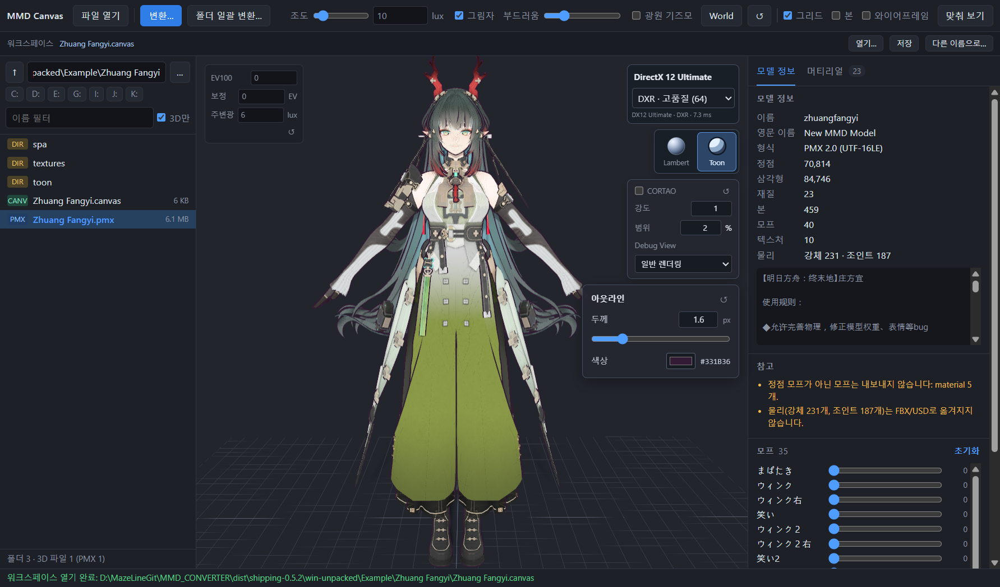
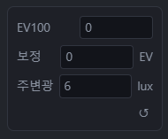
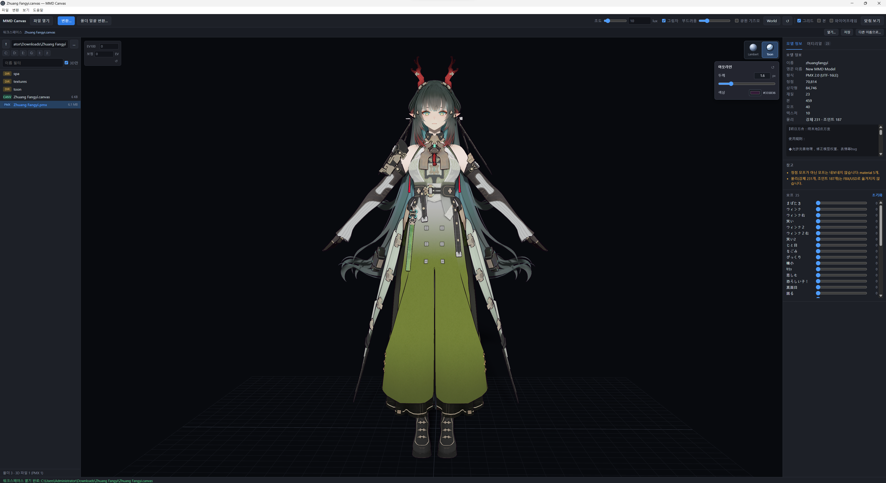

# MMD Canvas

**한국어** · [简体中文](docs/README.zh-CN.md) · [English](docs/README.en.md) · [日本語](docs/README.ja.md)

PMX(MMD) 모델을 미리 보고 **FBX / USD로 변환**하는 데스크톱 앱입니다. 폴더 탐색, 3D 뷰어, 단일·일괄 변환을 한 화면에서 제공합니다. 앱 내부와 CLI에서는 `MMD Converter`라는 이름도 사용합니다.



> v0.5.2 실행 화면입니다. `Example`의 모델·텍스처·워크스페이스를 설치 파일에 함께 포함합니다.

[배포 파일 다운로드](https://github.com/mazelines/MMD-Canvas/releases) · [CI 실행 결과](https://github.com/mazelines/MMD-Canvas/actions/workflows/ci.yml) · [릴리스 가이드](docs/releases.md)

## v0.5.5: DLAA · DLSS

기본 AA로 NVIDIA DLAA를 추가하고 DLSS Quality·Balanced와 MSAA 4×를 선택할 수 있게 했습니다. HDR 색상·깊이·모션 벡터로 EV100·GT7 이전에 복원하며 Lambert·Toon 모두 적용합니다. DLAA·DLSS는 RTX 20 시리즈 이상에서 지원하며 실제 사용 가능 여부는 GPU·드라이버에서 확인합니다. 지원하지 않는 GPU에서는 DX12 MSAA 4×를 사용합니다.

RTX 4090에서 배경색·노출 보존, 카메라·포즈 이동, CORTAO·DXR 합성과 1,200프레임 안정성 검증을 통과했습니다. 아주 가는 형상과 투명 경계에는 특히 Balanced에서 흔들림이 남을 수 있습니다. NVIDIA 배포 DLL과 별도 SDK 라이선스를 설치 파일에 포함합니다. [지원 조건·구조·제한](docs/dlss.md) · [0.5.5 변경 내용](docs/release-notes/v0.5.5.md).

## v0.5.4: 시간 누적 DXR 그림자

Lambert·Toon의 그림자를 1·2·4광선으로 계산하고, 카메라·스키닝·모프의 모션 벡터, 시간 누적, 깊이·기하 법선 기반 공간 필터로 복원합니다. 기본값은 4광선이며 128광선 참조 모드도 제공합니다. 정지 시 최대 32프레임을 누적한 뒤 추가 렌더링을 멈춥니다. 그림자는 재질의 직접광에 EV100·GT7 전에 적용합니다. [구조와 제한](docs/native-dx12.md#모션-벡터와-시간-누적-그림자).

실제 예제의 근접 화면에서 네이티브 렌더링 시간이 64광선 약 9.8ms에서 4광선+복원 약 1.9ms로 줄었습니다(RTX 4090, 1280×900). 카메라·포즈 변경과 가림 해제 회귀 테스트, 1,200프레임 안정성 검증을 통과했습니다. 화면 전송을 포함한 전체 FPS는 별도이며, 투명 레이어와 일부 MSAA 경계에는 미세한 노이즈가 남을 수 있습니다. [0.5.4 변경 내용](docs/release-notes/v0.5.4.md).

## v0.5.3: DXR shadow acne 수정

Lambert·Toon에서 표면이 자기 자신을 잘못 가리는 DXR 자기 교차를 수정했습니다. 그림자 광선은 실제 삼각형의 기하 법선과 위치 오차를 기준으로 출발하며, 강한 노멀맵이나 모델 전체 크기에 따라 시작점이 잘못 이동하던 문제를 개선했습니다. 가까운 의상·머리카락 같은 얇은 면의 그림자도 보존합니다.

크기 0.001~1,000배, 원거리 양·음 좌표, 앞·뒷면, 포즈 변경과 얇은 차폐물의 GPU 회귀 테스트를 통과했습니다. 실제 예제의 카메라 이동·리사이즈 1,200프레임에서 GPU 종료와 미반환 프레임이 없었습니다. [계산식과 검증 범위](docs/native-dx12.md#dxr-자기-교차-방지) · [0.5.3 변경 내용](docs/release-notes/v0.5.3.md).

## v0.5.2: DX12 Ultimate와 안정적인 GPU 화면 전송

**Windows 11 x64와 DirectX 12 Ultimate GPU(feature level 12_2, DXR 1.1 이상)가 필요합니다.** 3D 렌더러를 네이티브 DX12로 통합하고 WebGL 렌더링을 제거했습니다. macOS·Linux 배포는 제공하지 않습니다.

- **GPU 화면 멈춤 수정:** DX12 출력 표면을 화면 전송용 표면으로 GPU 복사한 뒤 반환합니다. 반환 대기 중인 표면이 3개면 새 렌더 요청을 대기시켜 공유 텍스처 풀 고갈을 방지합니다. GPU 연결 복구와 화면 새로 고침도 처리합니다.
- **DXR 소프트 그림자:** 광원 크기와 16·64·128 rays 품질 설정을 제공합니다.
- **CORTAO:** Lambert·Toon의 간접광에 재질 셰이더에서 적용하고, 이후 EV100·GT7 톤매핑을 수행합니다. 재질 AO와는 `min(materialAO, screenAO)`로 결합합니다. AO 전용·Raw AO Debug View를 제공합니다. [계산식과 프레임 순서](docs/native-dx12.md#cortao-합성식).
- **예제와 시작 화면:** `Example` 전체 56개 파일을 원본 그대로 포함합니다. 처음 실행하거나 이전 작업을 복원할 수 없으면 `Zhuang Fangyi.canvas`를 열고, 유효한 사용자 작업이 있으면 우선 복원합니다. 예제에는 AO 설정이 없어 CORTAO가 꺼진 상태로 열립니다.

실제 예제의 카메라 이동·창 크기 변경 1,200프레임, 지연된 프레임 반환, GPU 프로세스 재시작 후 복구, DXR·CORTAO·색상 보존을 검증했습니다. [요구 사항·구조·제한](docs/native-dx12.md) · [0.5.2 변경 내용](docs/release-notes/v0.5.2.md).

## v0.5.0: 주변광과 EV100

뷰포트 왼쪽 패널에서 노출과 주변광을 독립적으로 조절합니다.



| 항목 | 동작 | 기본값 / 범위 |
| --- | --- | --- |
| EV100 | 1 증가할 때 화면 밝기가 절반이 됩니다. 광원의 lux는 바뀌지 않습니다. | 0 / -10–24 |
| 보정 | +1 EV마다 화면 밝기가 두 배가 됩니다. | 0 / -10–10 EV |
| 주변광 | 방향광이 닿지 않는 면에 하늘·바닥의 보조광을 더합니다. 0이면 이 보조광을 끕니다. | 2 / 0–200,000 lux |

이미지의 주변광 6 lux는 설정 예시입니다. 주변광 숫자 칸을 더블클릭하면 2 lux로 돌아가고, ↺ 버튼은 EV100과 보정만 0 / 0으로 초기화합니다. 방향광은 상단의 별도 조도 설정을 사용합니다.

주변광은 로컬 설정과 `.canvas`에 저장됩니다. 주변광 항목이 없는 이전 작업 파일은 0 lux로 복원합니다. 새 저장 형식은 버전 2이며 기존 버전 1 파일도 읽을 수 있지만, 이전 앱에서는 새 파일을 열 수 없습니다. 필요한 경우 기존 파일을 보존하고 다른 이름으로 저장하세요.

노출·광량·발광의 음수나 소수 입력을 개선하고, 배경·그리드·기즈모·아웃라인 색상이 노출과 톤매핑의 영향을 덜 받도록 보정했습니다.

## v0.4.0 업데이트

- **물리 조명:** 방향광을 lux로 입력합니다. 기본 10 lux, 범위 0–200,000 lux이며 자동 보조광과 모드별 광량 배율을 제거했습니다.
- **수동 노출:** 뷰포트 왼쪽에서 EV100(-10–24)과 노출 보정(-10–10 EV)을 조절합니다. 기본값은 0 / 0이며 노출은 실제 광량을 변경하지 않습니다.
- **재질 발광:** 머티리얼 패널에서 발광 기준 휘도를 0–1,000,000 cd/m²로 조절하고 원본 환산값으로 복원할 수 있습니다. 발광 색상이 검은색이면 휘도만 높여도 밝아지지 않습니다.
- **앱 메뉴와 창:** 파일·변환·보기·도움말 메뉴를 제공하며, 모델이나 작업 파일을 다시 열면 실행 중인 창을 재사용합니다.
- **작업 호환성:** 노출과 재질별 발광을 `.canvas`에 저장합니다. 이전 조명 배율은 `값 × 6 lux`로 변환하며, 기존 작업의 노출 배율을 유지합니다. 물리 조명 도입으로 이전 화면과 밝기가 다를 수 있습니다.

## 언어와 작업 저장

v0.3.0에서 작업 저장·복원과 4개 언어 UI를 추가했습니다. Toon은 2단계 명암으로 개선했고, 두 렌더링 모드 모두 선형 색 공간과 GT7 SDR 톤매핑을 사용합니다.

앱을 시작할 때 시스템 언어를 따라 **한국어·영어·중국어(간체)·일본어**로 표시합니다. 그 외 언어는 영어로 표시합니다. 모델에 포함된 이름과 설명, 파일명은 그대로 유지합니다.

상단 작업 표시줄에서 **열기·저장·다른 이름으로 저장**을 사용할 수 있습니다. `.canvas`에는 모델과 폴더 경로, 카메라·조명·렌더링 모드·아웃라인, 재질 표시·모프, 변환 옵션과 출력 경로를 저장합니다. 모델 없이 폴더와 일괄 변환 설정만 저장할 수도 있습니다.

- `Ctrl+S`: 저장, `Ctrl+Shift+S`: 다른 이름으로 저장, `Ctrl+Shift+O`: 작업 열기.
- `.canvas`는 파일 열기, 드래그 앤 드롭 또는 실행 인자로 열 수 있습니다. 열면 설정을 복원하며 변환은 직접 실행합니다.
- 모델과 텍스처를 복사하거나 내장하지 않고 경로로 참조합니다. 같은 드라이브의 경로는 상대 경로로 저장하므로, 다른 위치로 옮길 때는 모델·텍스처와의 폴더 구조를 유지하세요.
- 화면 언어는 작업 파일에 저장하지 않습니다. 다른 언어의 시스템에서도 해당 시스템 언어로 열립니다.

## 현재 구현된 기능

- **파일 브라우저:** 드라이브·폴더 탐색, 파일명 필터, 3D 파일만 표시, 키보드 탐색, 드래그 앤 드롭.
- **3D 뷰어:** 카메라 회전·이동·확대, 모델에 맞춰 보기, 그리드·본·와이어프레임 표시, 재질별 표시 전환.
- **렌더링 모드:** 표준 모드(Lambert)와 심플 툰 모드(Toon)를 지원합니다. 뷰포트 우측 상단의 구 아이콘으로 전환하며, Toon에서는 2단계 명암과 두께·색상을 조절할 수 있는 아웃라인을 표시합니다.
- **Toon 아웃라인:** DX12 헐 패스에서 외곽선을 그립니다. 두께·색상과 스키닝·모프를 반영하며, 원본 표면 법선을 사용합니다.
- **애니메이션 재생:** 불러온 모델에 애니메이션 클립이 있으면(FBX·glTF/GLB·DAE·USD) 뷰포트 아래에 재생 바가 나타나고 바로 재생합니다. 재생·일시정지, 처음으로, 클립 선택, 타임라인 탐색, 속도(0.25–2×), 반복을 지원하며 그림자와 툰 아웃라인도 동작을 따라갑니다. PMX 파일에는 애니메이션이 들어 있지 않으므로 재생 바가 표시되지 않으며, VMD 모션 불러오기는 지원하지 않습니다.
- **PMX 검사:** 정점·삼각형·재질·본·모프·텍스처 정보, 모델 설명과 변환 경고, 정점 모프 슬라이더와 초기화.
- **머티리얼 검사:** 오른쪽 머티리얼 탭에서 재질·메시 이름 검색, 색상·불투명도·거칠기·금속성 등 표면 속성, 텍스처 미리보기와 확대·해상도·UV 정보, 사용 슬롯과 삼각형 수를 확인합니다. PMX 원본 값도 별도로 표시하며, 일반 모델에도 개별 표시·선택만 보기·모두 표시를 지원합니다. 표시 설정은 미리보기에만 적용됩니다.
- **조명과 그림자:** DXR 하드웨어 소프트 그림자를 사용합니다. 광원 크기로 부드러움을 조절하고, 시간 누적 품질은 1·2·4광선 중 선택합니다. 기본은 4광선이며, 비교용 128광선 참조 모드를 제공합니다.
- **광원 기즈모:** 광원 이동·회전, Local/World 좌표계 전환, 방향 초기화. 조명 세기·그림자 설정·광원 방향·좌표계 설정을 저장합니다.
- **변환:** PMX 단일 파일 또는 폴더 일괄 변환, 하위 폴더 포함, 스케일·이름·모프·텍스처 복사 옵션, 결과 폴더 열기.

## 표준 / 심플 툰 렌더링

두 모드 모두 Linear Rec.709 공간에서 조명·투명도·그림자를 합성하고, 마지막에 GT7 SDR 톤매핑과 sRGB 출력 변환을 적용합니다. [색 공간과 GT7 설정](docs/color-pipeline.md).

방향광 조도는 **lux**, 기본값은 **10 lux**입니다. 숫자 입력으로 0–200,000 lux를 지정하고 슬라이더 더블클릭으로 10 lux를 복원합니다. Lambert는 `반사율 × 조도 × max(N·L, 0) × 그림자 가시성 / π`로 휘도를 계산합니다. 자동 보조광과 광량 배율은 적용하지 않습니다.

뷰포트 왼쪽에서 **EV100·노출 보정**을 조절합니다(기본 0 / 0). EV100 +1은 절반 밝기, 보정 +1 EV는 두 배 밝기입니다. 머티리얼 패널의 **발광 기준 휘도**(cd/m²)는 직접광과 같은 단위로 합성한 후 노출·GT7을 적용합니다. 노출과 재질별 발광 설정은 `.canvas`에 저장하며 원본 재질과 변환 결과는 보존합니다.

뷰포트 우측 상단의 **Lambert / Toon** 버튼으로 렌더링 방식을 전환합니다.

| 모드 | 화면 표현 | 사용 예 |
| --- | --- | --- |
| **표준 모드 · Lambert** | 부드럽게 이어지는 명암으로 표면을 표시하며 툰 아웃라인은 숨깁니다. 기본 선택 모드입니다. | 모델 형태·텍스처와 조명 확인 |
| **심플 툰 모드 · Toon** | 명암을 2단계로 나누고 모델 외곽에 아웃라인을 표시합니다. | 캐릭터의 셀 셰이딩과 실루엣 미리보기 |

Toon의 투영 그림자는 어두운 면과 같은 톤으로 합성하며, 그림자가 겹친 부분을 추가로 어둡게 만들지 않습니다. 반구 보조광은 주변광 lux 설정으로 조절합니다. DXR 그림자의 부드러운 경계는 두 톤 사이를 보간하며, 텍스처·발광·AO 등 원본 재질에 포함된 색상 변화는 유지합니다.



Toon을 선택하면 버튼 아래에 **아웃라인 설정**이 나타납니다.

- **두께:** 슬라이더 또는 숫자 입력으로 0–8px 범위에서 조절합니다. 기본값은 1.6px이며, 0px로 설정하면 명암은 유지하고 아웃라인만 숨깁니다.
- **색상:** 색상 선택기로 변경합니다. 기본값은 `#151923`입니다.
- **초기화:** 아웃라인 설정의 ↺ 버튼으로 기본 두께와 색상을 복원합니다.
- **설정 유지:** 선택한 렌더링 모드와 아웃라인 설정은 다음 실행에도 유지됩니다.

렌더링 모드 전환은 뷰포트 미리보기에만 적용됩니다. 원본 재질 정보와 FBX/USD 변환 결과를 툰 재질로 변경하지 않습니다. 심플 툰 모드는 MMD의 원본 툰·스피어 재질을 그대로 재현하는 기능은 아니며, 사용자 정의 GLSL 셰이더는 지원하지 않습니다.

> 표준 / 심플 툰 렌더링과 머티리얼 패널은 `v0.2.0`부터 제공됩니다.

## CORTAO 접촉 음영

**Windows 11 / DirectX 12 Ultimate 전용**입니다. DX12 Ultimate GPU가 필요하며, DXR 하드웨어 소프트 그림자는 기본 4광선과 시간 누적·디노이징을 사용합니다. CORTAO와 조명은 EV100·GT7 전에 적용합니다. 초기화 실패 시 오류를 표시하며 다른 렌더러로 전환하지 않습니다. [구조·요구 사항·현재 지원 범위](docs/native-dx12.md).

**CORTAO → Debug View**에서 `AO만 보기`는 필터·강도를 적용한 차폐량을, `필터 전 AO`는 계산 원본을 표시합니다. 검정은 차폐, 흰색은 개방이며 배경은 회색입니다. 조명·텍스처·노출과 무관하게 확인할 수 있습니다. `일반 렌더링`으로 복귀하며, 디버그 선택은 작업 파일에 저장하지 않습니다. CORTAO가 꺼져 있으면 모델은 흰색으로 표시되고 안내 문구가 나타납니다.

Lambert와 Toon 모두 뷰포트 우측 **CORTAO** 패널에서 켜기/끄기, 강도(0–2), 범위(모델 크기의 0.1–10%)를 조절합니다. 기본값은 켜짐·강도 1·범위 2%입니다. 주변광이 틈과 접촉부에 덜 들어오도록 하며, 주변광이 0 lux이면 효과가 없습니다. 직접광·발광·툰 외곽선은 유지합니다.

Daniel Isheden의 CORTAO 1.0.3 HLSL을 전체 해상도에서 32 samples / 32 rays로 계산합니다. 카메라·모프·애니메이션 변화에 맞춰 갱신하며, 화면 밖 형상의 차폐는 계산하지 않습니다. 설정은 다음 실행과 `.canvas`에 저장합니다. 기존 GTAO 설정은 CORTAO로 옮기고, AO 설정 자체가 없는 이전 작업은 꺼진 상태로 엽니다. 와이어프레임에서는 적용을 생략합니다. [구현·라이선스](renderer/vendor/cortao/README.md)

## 지원 형식

| 용도 | 형식 |
| --- | --- |
| 뷰어 입력 | PMX, FBX, glTF/GLB, OBJ, STL, PLY, DAE, 3MF, USD/USDA/USDC/USDZ |
| 변환 입력 | PMX |
| 변환 출력 | FBX binary 7.4, USDA 텍스트, USDZ 패키지 |

일반 3D 형식은 three.js 로더를 사용하므로 파일별 확장 기능이나 재질 표현에는 차이가 있을 수 있습니다. `.usd`로 출력하면 USDA 텍스트가 저장되며, USDC 바이너리 출력은 구현되어 있지 않습니다.

## 실행

소스에서 실행하려면 **Windows 11 x64, Node.js 24 이상, Visual Studio C++ x64 도구와 Windows SDK DXC**가 필요합니다.

```bash
npm ci
npm run build:dx12
npm start
npm start -- model.pmx    # 지정한 모델을 바로 열기
```

배포 대상은 Windows 11 x64입니다. 현재 빌드는 서명되지 않았으며 앱 내 자동 업데이트는 포함하지 않습니다. DX12 Ultimate GPU가 필요하며 다른 렌더러로 전환하는 호환 경로는 없습니다.

Shipping 빌드는 로컬 `Example` 폴더의 모든 파일을 설치 폴더에 그대로 포함합니다. 파일을 지정해 실행하지 않았다면 마지막으로 열거나 저장한 워크스페이스를 복원하고, 복원할 프로젝트가 없으면 설치 폴더의 `Example/Zhuang Fangyi/Zhuang Fangyi.canvas`를 자동으로 엽니다. 예전 실행 기록이나 재설치 여부에 영향을 받지 않습니다.

## 뷰어 조작

| 조작 | 기능 |
| --- | --- |
| 마우스 왼쪽 드래그 / 오른쪽 드래그 / 휠 | 카메라 회전 / 이동 / 확대·축소 |
| 파일 목록에서 ↑ / ↓ | 파일 선택 및 미리보기 |
| Enter / Backspace | 폴더 진입 / 상위 폴더 |
| F | 모델에 맞춰 보기 |
| Space | 애니메이션 재생 / 일시정지 (클립이 있는 모델) |
| Ctrl+O / Ctrl+E | 파일 열기 / PMX 변환 |
| W / E | 광원 기즈모 이동 / 회전 모드 |
| X 또는 Local/World 버튼 | 광원 기즈모 좌표계 전환 |
| ↺ 버튼 | 광원 방향 초기화 |
| 조명·부드러움 슬라이더 더블클릭 | 해당 값 초기화 |
| F12 | 개발자 도구 |

광원 조작 단축키는 **광원 기즈모**를 켠 상태에서 사용합니다. 텍스트 입력 중이거나 변환 대화상자가 열려 있으면 일반 뷰어 단축키가 동작하지 않습니다.

## 명령줄 변환

```bash
node cli.js model.pmx                                  # model.fbx
node cli.js model.pmx -o out/model.usda                 # 출력 확장자로 형식 결정
node cli.js models/ -o out/ -f usdz -r                  # 하위 폴더까지 일괄 변환
node cli.js model.pmx -n english -s 8                  # 영어 이름과 스케일 지정
node cli.js model.pmx -o out/model.usdz --ascii         # USD prim 이름을 ASCII로 제한
node cli.js model.pmx --no-morphs --no-copy-textures    # 모프 제외, 원본 텍스처 경로 참조
node cli.js info model.pmx                             # 모델 정보 출력
node cli.js --help
```

## 변환 범위와 제한

| 항목 | FBX | USDA / USDZ |
| --- | --- | --- |
| 메시 · 노멀 · UV | 지원 | 지원 |
| 재질 · 디퓨즈 텍스처 | Phong | UsdPreviewSurface, GeomSubset |
| 본 · 스킨 가중치 | Skin / Cluster / BindPose | UsdSkel |
| 정점 모프 · 정점 모프로만 구성된 그룹 모프 | BlendShape | BlendShape |
| 물리 · IK · 본/UV/재질 모프 · 스피어/툰 | 미지원 | 미지원 |

- 좌표계는 왼손에서 오른손 Y-up으로 변환하며 Z축·면 방향·UV V를 반전합니다.
- 기본 스케일은 8입니다. MMD 1단위를 8cm로 처리하며 출력 단위는 cm입니다.
- 이름은 원본을 유지하는 것이 기본이며 영어 모드에서 표준 본 이름을 자동 번역합니다.
- SDEF / QDEF 정점은 선형 스키닝(BDEF2 / BDEF4)으로 변환합니다.
- 텍스처는 `<출력이름>_textures/`로 복사하고 USDZ에서는 패키지에 포함합니다. 텍스처의 실제 알파 사용 여부를 판별합니다.
- PMD 입력은 지원하지 않습니다. PMX로 변환한 뒤 사용하세요.

## 검증과 빌드

```bash
npm test                            # 변환 코어·그림자·머티리얼 데이터 테스트
npm run test:ui                     # npm test 후 실행: PMX/FBX 머티리얼·툰 모드 UI 검증
npm run test:workspace              # npm test 후 실행: 작업 저장·복원, 4개 언어와 영어 폴백 UI 검증
node tests/run-tests.js --blender    # Blender를 설치한 경우 추가 임포트 검증
node tests/make-heavy.js             # 그림자 성능 확인용 고밀도 OBJ 생성
npm run pack                        # 실행 가능한 앱 폴더 생성
npm run dist                        # 현재 OS 배포 파일 생성
```

테스트 입력과 출력은 `tests/sample/`, `tests/out/`에 생성되며 Git에서 제외합니다. Blender 실행 파일은 `BLENDER` 환경변수로 지정하거나 `PATH`에 등록할 수 있습니다. 배포 빌드는 `dist/`에 저장됩니다.

## CI/CD

- `main` push 및 PR에서 Windows 코어 테스트, Python 문법 검사, DX12 컴파일과 앱 패키징을 검증합니다. `npm run test:dx12`는 DX12 Ultimate GPU가 있는 로컬 PC에서 실행합니다.
- `v*` 태그를 push하면 버전 검사와 테스트 후 4개 플랫폼·아키텍처 배포 파일을 빌드합니다. 모두 성공하면 GitHub Release에 파일과 SHA-256 체크섬을 등록합니다.
- Actions의 **Release → Run workflow**에서 브랜치를 선택하면 릴리스를 게시하지 않고 빌드 결과를 받을 수 있습니다.
- Dependabot이 npm 의존성과 GitHub Actions 업데이트를 매주 확인합니다.

릴리스 브랜치에서 버전을 올리고 `package.json`과 `package-lock.json`을 커밋해 PR로 병합합니다.

```bash
npm version patch --no-git-tag-version
```

CI 통과 후 병합된 최신 `main`에서 패키지 버전과 일치하는 `vX.Y.Z` 태그를 생성·푸시하면 릴리스가 시작됩니다. 자세한 절차와 서명 관련 설정은 [릴리스 가이드](docs/releases.md)를 참고하세요.

## 구현 구조

JavaScript(ES modules), Electron, three.js, HTML/CSS를 사용합니다. Blender 임포트 검증은 Python으로 작성되어 있습니다.

```text
src/core/             PMX 파서, 씬 정규화, FBX/USD 출력, 변환 파이프라인
electron/             메인 프로세스, preload, 파일 접근과 IPC
renderer/             파일 브라우저, 뷰어, DXR 그림자(shadows.js), 광원 기즈모
cli.js                명령줄 변환기
tests/                합성 PMX·고밀도 OBJ 생성기, 코어 테스트, Blender 검증
.github/workflows/    CI와 릴리스 자동화
electron-builder.yml  운영체제별 패키징 설정
docs/                 실행 화면과 릴리스 가이드
```

## 라이선스

코드는 [MIT License](LICENSE)를 따릅니다. 사용자가 불러오는 모델과 텍스처에는 각 제작자의 이용 조건이 적용됩니다.

GT7 참조 구현의 MIT 고지는 [GT7-MIT.txt](licenses/GT7-MIT.txt)에 있으며 배포 패키지에도 포함됩니다.
