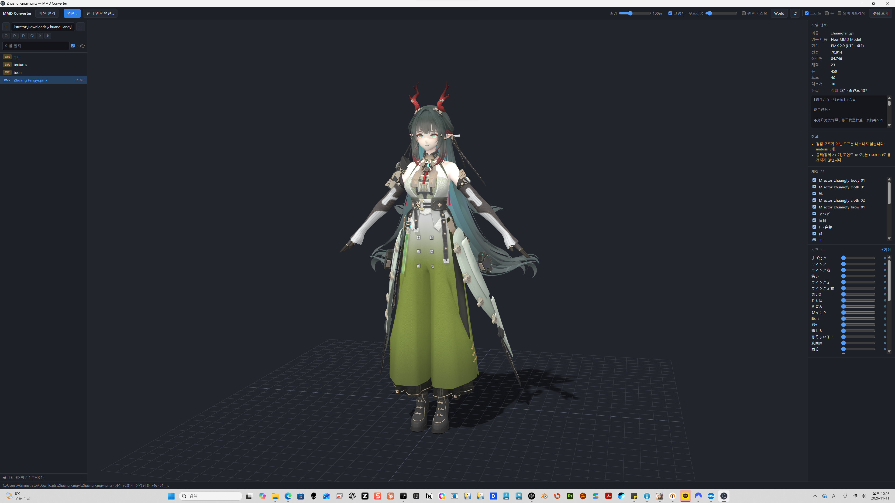
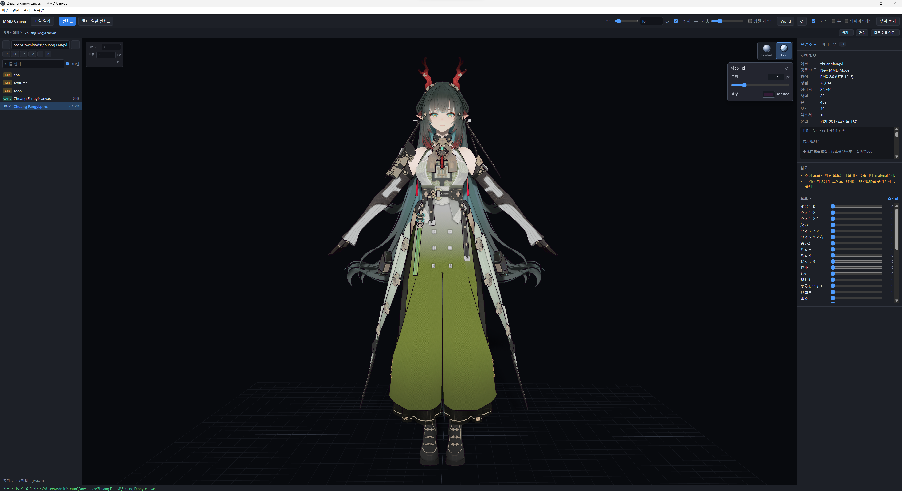

# MMD Canvas

**한국어** · [简体中文](docs/README.zh-CN.md) · [English](docs/README.en.md) · [日本語](docs/README.ja.md)

PMX(MMD) 모델을 미리 보고 **FBX / USD로 변환**하는 데스크톱 앱입니다. 폴더 탐색, 3D 뷰어, 단일·일괄 변환을 한 화면에서 제공합니다. 앱 내부와 CLI에서는 `MMD Converter`라는 이름도 사용합니다.



> v0.2.0의 기능을 보여 주는 실행 화면입니다. 예시 모델 파일은 저장소에 포함하지 않습니다.

[배포 파일 다운로드](https://github.com/mazelines/MMD-Canvas/releases) · [CI 실행 결과](https://github.com/mazelines/MMD-Canvas/actions/workflows/ci.yml) · [릴리스 가이드](docs/releases.md)

## v0.4.0 업데이트

- **물리 조명:** 방향광을 lux로 입력합니다. 기본 10 lux, 범위 0–200,000 lux이며 자동 보조광과 모드별 광량 배율을 제거했습니다.
- **수동 노출:** 뷰포트 왼쪽에서 EV100(-10–24)과 노출 보정(-10–10 EV)을 조절합니다. 기본값은 0 / 0이며 노출은 실제 광량을 변경하지 않습니다.
- **재질 발광:** 머티리얼 패널에서 발광 기준 휘도를 0–1,000,000 cd/m²로 조절하고 원본 환산값으로 복원할 수 있습니다. 발광 색상이 검은색이면 휘도만 높여도 밝아지지 않습니다.
- **앱 메뉴와 창:** 파일·변환·보기·도움말 메뉴를 제공하며, 모델이나 작업 파일을 다시 열면 실행 중인 창을 재사용합니다.
- **작업 호환성:** 노출과 재질별 발광을 `.canvas`에 저장합니다. 이전 조명 배율은 `값 × 6 lux`로 변환하며, 기존 작업의 노출 배율을 유지합니다. 물리 조명 도입으로 이전 화면과 밝기가 다를 수 있습니다.

## 언어와 작업 저장

v0.3.0에서 작업 저장·복원과 4개 언어 UI를 추가했습니다. Toon은 2단계 명암으로 개선했고, 두 렌더링 모드 모두 선형 색 공간과 GT7 SDR 톤매핑을 사용합니다.

앱을 시작할 때 시스템 언어를 따라 **한국어·영어·중국어(간체)·일본어**로 표시합니다. 그 외 언어는 영어로 표시합니다. 모델에 포함된 이름과 설명, 파일명은 그대로 유지합니다.

상단 작업 표시줄에서 **열기·저장·다른 이름으로 저장**을 사용할 수 있습니다. `.canvas`에는 모델과 폴더 경로, 카메라·조명·렌더링 모드·아웃라인, 재질 표시·모프, 변환 옵션과 출력 경로를 저장합니다. 모델 없이 폴더와 일괄 변환 설정만 저장할 수도 있습니다.

- `Ctrl+S`: 저장, `Ctrl+Shift+S`: 다른 이름으로 저장, `Ctrl+Shift+O`: 작업 열기. macOS에서는 `Cmd`를 사용합니다.
- `.canvas`는 파일 열기, 드래그 앤 드롭 또는 실행 인자로 열 수 있습니다. 열면 설정을 복원하며 변환은 직접 실행합니다.
- 모델과 텍스처를 복사하거나 내장하지 않고 경로로 참조합니다. 같은 드라이브의 경로는 상대 경로로 저장하므로, 다른 위치로 옮길 때는 모델·텍스처와의 폴더 구조를 유지하세요.
- 화면 언어는 작업 파일에 저장하지 않습니다. 다른 언어의 시스템에서도 해당 시스템 언어로 열립니다.

## 현재 구현된 기능

- **파일 브라우저:** 드라이브·폴더 탐색, 파일명 필터, 3D 파일만 표시, 키보드 탐색, 드래그 앤 드롭.
- **3D 뷰어:** 카메라 회전·이동·확대, 모델에 맞춰 보기, 그리드·본·와이어프레임 표시, 재질별 표시 전환.
- **렌더링 모드:** 표준 모드(Lambert)와 심플 툰 모드(Toon)를 지원합니다. 뷰포트 우측 상단의 구 아이콘으로 전환하며, Toon에서는 2단계 명암과 두께·색상을 조절할 수 있는 아웃라인을 표시합니다.
- **Smooth Normal 아웃라인:** 별도 패킹 채널 없이 위치가 같은 정점들을 런타임에 묶고, 면의 각도로 가중한 법선을 계산해 UV·하드 에지 경계를 이어 줍니다. 원본 표면 법선은 보존하며, 정점·모프가 바뀔 때만 아웃라인 법선을 다시 계산합니다. 최초 Toon 전환 시 계산한 결과는 이후 프레임에서 재사용합니다.
- **PMX 검사:** 정점·삼각형·재질·본·모프·텍스처 정보, 모델 설명과 변환 경고, 정점 모프 슬라이더와 초기화.
- **머티리얼 검사:** 오른쪽 머티리얼 탭에서 재질·메시 이름 검색, 색상·불투명도·거칠기·금속성 등 표면 속성, 텍스처 미리보기와 확대·해상도·UV 정보, 사용 슬롯과 삼각형 수를 확인합니다. PMX 원본 값도 별도로 표시하며, 일반 모델에도 개별 표시·선택만 보기·모두 표시를 지원합니다. 표시 설정은 미리보기에만 적용됩니다.
- **조명과 그림자:** 조명 세기, PCSS 소프트 그림자, 광원 크기에 따른 부드러움 조절. 모델에 맞춘 4096 × 4096 섀도 맵을 사용하며 모델·재질·광원이 바뀔 때 갱신합니다.
- **광원 기즈모:** 광원 이동·회전, Local/World 좌표계 전환, 방향 초기화. 조명 세기·그림자 설정·광원 방향·좌표계 설정을 저장합니다.
- **변환:** PMX 단일 파일 또는 폴더 일괄 변환, 하위 폴더 포함, 스케일·이름·모프·텍스처 복사 옵션, 결과 폴더 열기.

## 표준 / 심플 툰 렌더링

두 모드 모두 Linear Rec.709 공간에서 조명·투명도·그림자를 합성하고, 마지막에 GT7 SDR 톤매핑과 sRGB 출력 변환을 적용합니다. [색 공간과 GT7 설정](docs/color-pipeline.md).

방향광 조도는 **lux**, 기본값은 **10 lux**입니다. 숫자 입력으로 0–200,000 lux를 지정하고 슬라이더 더블클릭으로 10 lux를 복원합니다. Lambert는 `반사율 × 조도 × max(N·L, 0) × 그림자 가시성 / π`로 휘도를 계산합니다. 자동 보조광과 광량 배율은 적용하지 않습니다.

뷰포트 왼쪽에서 **EV100·노출 보정**을 조절합니다(기본 0 / 0). EV100 +1은 절반 밝기, 보정 +1 EV는 두 배 밝기입니다. 머티리얼 패널의 **발광 기준 휘도**(cd/m²)는 직접광과 같은 단위로 합성한 후 노출·GT7을 적용합니다. 노출과 재질별 발광 설정은 `.canvas`에 저장하며 원본 재질과 변환 결과는 보존합니다.

뷰포트 우측 상단의 **Lambert / Toon** 버튼으로 렌더링 방식을 전환합니다.

| 모드 | 화면 표현 | 사용 예 |
| --- | --- | --- |
| **표준 모드 · Lambert** | 부드럽게 이어지는 명암으로 표면을 표시하며 툰 아웃라인은 숨깁니다. 기본 선택 모드입니다. | 모델 형태·텍스처와 조명 확인 |
| **심플 툰 모드 · Toon** | 명암을 2단계로 나누고 모델 외곽에 아웃라인을 표시합니다. | 캐릭터의 셀 셰이딩과 실루엣 미리보기 |

Toon의 투영 그림자는 어두운 면과 같은 톤으로 합성하며, 그림자가 겹친 부분을 추가로 어둡게 만들지 않습니다. 자동 반구 보조광은 적용하지 않습니다. PCSS 그림자의 부드러운 경계는 두 톤 사이를 보간하며, 텍스처·발광·AO 등 원본 재질에 포함된 색상 변화는 유지합니다.



Toon을 선택하면 버튼 아래에 **아웃라인 설정**이 나타납니다.

- **두께:** 슬라이더 또는 숫자 입력으로 0–8px 범위에서 조절합니다. 기본값은 1.6px이며, 0px로 설정하면 명암은 유지하고 아웃라인만 숨깁니다.
- **색상:** 색상 선택기로 변경합니다. 기본값은 `#151923`입니다.
- **초기화:** 아웃라인 설정의 ↺ 버튼으로 기본 두께와 색상을 복원합니다.
- **설정 유지:** 선택한 렌더링 모드와 아웃라인 설정은 다음 실행에도 유지됩니다.

렌더링 모드 전환은 뷰포트 미리보기에만 적용됩니다. 원본 재질 정보와 FBX/USD 변환 결과를 툰 재질로 변경하지 않습니다. 심플 툰 모드는 MMD의 원본 툰·스피어 재질을 그대로 재현하는 기능은 아니며, 사용자 정의 셰이더 재질은 자체 렌더링을 유지합니다.

> 표준 / 심플 툰 렌더링과 머티리얼 패널은 `v0.2.0`부터 제공됩니다.

## 지원 형식

| 용도 | 형식 |
| --- | --- |
| 뷰어 입력 | PMX, FBX, glTF/GLB, OBJ, STL, PLY, DAE, 3MF, USD/USDA/USDC/USDZ |
| 변환 입력 | PMX |
| 변환 출력 | FBX binary 7.4, USDA 텍스트, USDZ 패키지 |

일반 3D 형식은 three.js 로더를 사용하므로 파일별 확장 기능이나 재질 표현에는 차이가 있을 수 있습니다. `.usd`로 출력하면 USDA 텍스트가 저장되며, USDC 바이너리 출력은 구현되어 있지 않습니다.

## 실행

소스에서 실행하려면 **Node.js 24 이상과 npm**이 필요합니다.

```bash
npm ci
npm start
npm start -- model.pmx    # 지정한 모델을 바로 열기
```

배포 파일은 Windows x64 설치 프로그램, macOS Apple Silicon/Intel ZIP, Linux x64 AppImage로 제공합니다. 현재 배포물은 인증서 없는 빌드이며 앱 내 자동 업데이트는 포함하지 않습니다.

## 뷰어 조작

| 조작 | 기능 |
| --- | --- |
| 마우스 왼쪽 드래그 / 오른쪽 드래그 / 휠 | 카메라 회전 / 이동 / 확대·축소 |
| 파일 목록에서 ↑ / ↓ | 파일 선택 및 미리보기 |
| Enter / Backspace | 폴더 진입 / 상위 폴더 |
| F | 모델에 맞춰 보기 |
| Ctrl+O / Ctrl+E | 파일 열기 / PMX 변환 |
| W / E | 광원 기즈모 이동 / 회전 모드 |
| X 또는 Local/World 버튼 | 광원 기즈모 좌표계 전환 |
| ↺ 버튼 | 광원 방향 초기화 |
| 조명·부드러움 슬라이더 더블클릭 | 해당 값 초기화 |
| F12 | 개발자 도구 |

광원 조작 단축키는 **광원 기즈모**를 켠 상태에서 사용합니다. 텍스트 입력 중이거나 변환 대화상자가 열려 있으면 일반 뷰어 단축키가 동작하지 않습니다.

## 명령줄 변환

```bash
node cli.js model.pmx                                  # model.fbx
node cli.js model.pmx -o out/model.usda                 # 출력 확장자로 형식 결정
node cli.js models/ -o out/ -f usdz -r                  # 하위 폴더까지 일괄 변환
node cli.js model.pmx -n english -s 8                  # 영어 이름과 스케일 지정
node cli.js model.pmx -o out/model.usdz --ascii         # USD prim 이름을 ASCII로 제한
node cli.js model.pmx --no-morphs --no-copy-textures    # 모프 제외, 원본 텍스처 경로 참조
node cli.js info model.pmx                             # 모델 정보 출력
node cli.js --help
```

## 변환 범위와 제한

| 항목 | FBX | USDA / USDZ |
| --- | --- | --- |
| 메시 · 노멀 · UV | 지원 | 지원 |
| 재질 · 디퓨즈 텍스처 | Phong | UsdPreviewSurface, GeomSubset |
| 본 · 스킨 가중치 | Skin / Cluster / BindPose | UsdSkel |
| 정점 모프 · 정점 모프로만 구성된 그룹 모프 | BlendShape | BlendShape |
| 물리 · IK · 본/UV/재질 모프 · 스피어/툰 | 미지원 | 미지원 |

- 좌표계는 왼손에서 오른손 Y-up으로 변환하며 Z축·면 방향·UV V를 반전합니다.
- 기본 스케일은 8입니다. MMD 1단위를 8cm로 처리하며 출력 단위는 cm입니다.
- 이름은 원본을 유지하는 것이 기본이며 영어 모드에서 표준 본 이름을 자동 번역합니다.
- SDEF / QDEF 정점은 선형 스키닝(BDEF2 / BDEF4)으로 변환합니다.
- 텍스처는 `<출력이름>_textures/`로 복사하고 USDZ에서는 패키지에 포함합니다. 텍스처의 실제 알파 사용 여부를 판별합니다.
- PMD 입력은 지원하지 않습니다. PMX로 변환한 뒤 사용하세요.

## 검증과 빌드

```bash
npm test                            # 변환 코어·그림자·머티리얼 데이터 테스트
npm run test:ui                     # npm test 후 실행: PMX/FBX 머티리얼·툰 모드 UI 검증
npm run test:workspace              # npm test 후 실행: 작업 저장·복원, 4개 언어와 영어 폴백 UI 검증
node tests/run-tests.js --blender    # Blender를 설치한 경우 추가 임포트 검증
node tests/make-heavy.js             # 그림자 성능 확인용 고밀도 OBJ 생성
npm run pack                        # 실행 가능한 앱 폴더 생성
npm run dist                        # 현재 OS 배포 파일 생성
```

테스트 입력과 출력은 `tests/sample/`, `tests/out/`에 생성되며 Git에서 제외합니다. Blender 실행 파일은 `BLENDER` 환경변수로 지정하거나 `PATH`에 등록할 수 있습니다. 배포 빌드는 `dist/`에 저장됩니다.

## CI/CD

- `main` push 및 PR에서 Windows·macOS·Linux 코어 테스트, Python 문법 검사, 앱 패키징을 검증합니다.
- `v*` 태그를 push하면 버전 검사와 테스트 후 4개 플랫폼·아키텍처 배포 파일을 빌드합니다. 모두 성공하면 GitHub Release에 파일과 SHA-256 체크섬을 등록합니다.
- Actions의 **Release → Run workflow**에서 브랜치를 선택하면 릴리스를 게시하지 않고 빌드 결과를 받을 수 있습니다.
- Dependabot이 npm 의존성과 GitHub Actions 업데이트를 매주 확인합니다.

릴리스 브랜치에서 버전을 올리고 `package.json`과 `package-lock.json`을 커밋해 PR로 병합합니다.

```bash
npm version patch --no-git-tag-version
```

CI 통과 후 병합된 최신 `main`에서 패키지 버전과 일치하는 `vX.Y.Z` 태그를 생성·푸시하면 릴리스가 시작됩니다. 자세한 절차와 서명 관련 설정은 [릴리스 가이드](docs/releases.md)를 참고하세요.

## 구현 구조

JavaScript(ES modules), Electron, three.js, HTML/CSS를 사용합니다. Blender 임포트 검증은 Python으로 작성되어 있습니다.

```text
src/core/             PMX 파서, 씬 정규화, FBX/USD 출력, 변환 파이프라인
electron/             메인 프로세스, preload, 파일 접근과 IPC
renderer/             파일 브라우저, 뷰어, PCSS 그림자(shadows.js), 광원 기즈모
cli.js                명령줄 변환기
tests/                합성 PMX·고밀도 OBJ 생성기, 코어 테스트, Blender 검증
.github/workflows/    CI와 릴리스 자동화
electron-builder.yml  운영체제별 패키징 설정
docs/                 실행 화면과 릴리스 가이드
```

## 라이선스

코드는 [MIT License](LICENSE)를 따릅니다. 사용자가 불러오는 모델과 텍스처에는 각 제작자의 이용 조건이 적용됩니다.

GT7 참조 구현의 MIT 고지는 [GT7-MIT.txt](licenses/GT7-MIT.txt)에 있으며 배포 패키지에도 포함됩니다.
