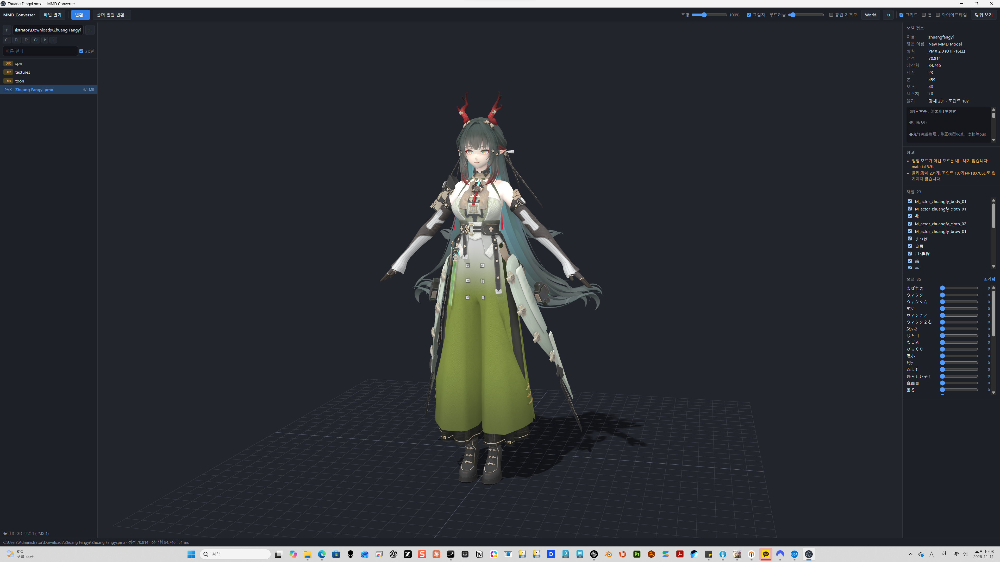
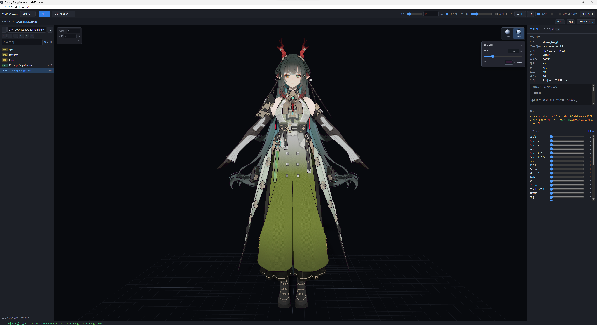

# MMD Canvas

[한국어](../README.md) · [简体中文](README.zh-CN.md) · **English** · [日本語](README.ja.md)

A desktop app for previewing PMX (MMD) models and **converting them to FBX / USD**. It combines a file browser, 3D viewer, and single-file or batch conversion. The app and CLI also use the name `MMD Converter`.



> Screenshots illustrate features available in v0.2.0. The example model is not included in this repository.

[Downloads](https://github.com/mazelines/MMD-Canvas/releases) · [CI results](https://github.com/mazelines/MMD-Canvas/actions/workflows/ci.yml) · [Release guide (Korean)](releases.md)

## Features

- **File browser:** browse drives and folders, filter by filename or 3D format, navigate with the keyboard, and drag and drop files.
- **3D viewer:** orbit, pan, zoom, frame the model, toggle grid/bones/wireframe, and control material visibility.
- **Rendering modes:** standard Lambert shading and simple Toon shading with three lighting bands and adjustable outlines.
- **Smooth-normal outlines:** vertices at the same position are grouped at runtime to calculate angle-weighted normals across UV seams and hard edges. Original surface normals are preserved. Outline normals are calculated on first use and reused until vertices or morphs change; no extra packed channel is required.
- **PMX inspection:** vertex, triangle, material, bone, morph, and texture counts; model descriptions and conversion warnings; vertex morph sliders and reset.
- **Material inspector:** search material/mesh names; inspect color, opacity, roughness, metalness, texture previews, resolution, UV data, material slots, and triangle counts. View original PMX values separately. Toggle individual materials, isolate the selection, or show all, including on non-PMX models. Visibility changes affect previews only.
- **Lighting and shadows:** light intensity and PCSS soft shadows with adjustable light size. A 4096 × 4096 shadow map is fitted to the model and refreshed when the model, materials, or light change.
- **Light gizmo:** translation, rotation, Local/World coordinates, and direction reset. Lighting, shadow, direction, and coordinate-space preferences are saved.
- **Conversion:** single PMX files or entire folders, optional recursion, scale/name/morph/texture-copy options, and opening the output folder.

## Standard / simple Toon rendering

Use the **Lambert / Toon** sphere buttons at the top right of the viewport.

| Mode | Appearance | Useful for |
| --- | --- | --- |
| **Standard · Lambert** | Smooth lighting without Toon outlines; the default mode. | Inspecting shape, textures, and lighting |
| **Simple Toon** | Three lighting bands and silhouette outlines. | Previewing cel shading and character silhouettes |



Selecting Toon reveals outline controls below the buttons:

- **Width:** slider or numeric input, 0–8px; default 1.6px. Setting 0px hides outlines while retaining Toon shading.
- **Color:** choose a color; default `#151923`.
- **Reset:** the outline panel's ↺ button restores the default width and color.
- **Persistence:** the mode and outline settings are restored on the next launch.

These modes affect viewport previews only. They do not replace original material data or turn FBX/USD exports into Toon materials. Simple Toon does not fully reproduce original MMD toon/sphere materials; custom shader materials retain their own rendering.

> Rendering modes and the material inspector are available from `v0.2.0`.

## Supported formats

| Use | Formats |
| --- | --- |
| Viewer input | PMX, FBX, glTF/GLB, OBJ, STL, PLY, DAE, 3MF, USD/USDA/USDC/USDZ |
| Conversion input | PMX |
| Conversion output | FBX binary 7.4, USDA text, USDZ package |

General 3D formats use three.js loaders; extensions and material rendering may vary by file. Exporting to `.usd` writes USDA text. Binary USDC export is not implemented.

## Run

Running from source requires **Node.js 24 or newer and npm**.

```bash
npm ci
npm start
npm start -- model.pmx    # Open a model at startup
```

Downloads include a Windows x64 installer, macOS Apple Silicon/Intel ZIPs, and a Linux x64 AppImage. Current builds are unsigned and do not include in-app automatic updates.

## Viewer controls

| Input | Action |
| --- | --- |
| Left drag / right drag / wheel | Orbit / pan / zoom |
| ↑ / ↓ in file list | Select and preview |
| Enter / Backspace | Enter folder / go to parent |
| F | Frame model |
| Ctrl+O / Ctrl+E | Open file / convert PMX |
| W / E | Translate / rotate light gizmo |
| X or Local/World button | Switch gizmo coordinate space |
| ↺ light button | Reset light direction |
| Double-click light/softness slider | Reset that value |
| F12 | Developer tools |

Enable the light gizmo to use its shortcuts. General viewer shortcuts are inactive while entering text or while the conversion dialog is open.

## Command-line conversion

```bash
node cli.js model.pmx                                  # Write model.fbx
node cli.js model.pmx -o out/model.usda                 # Infer format from extension
node cli.js models/ -o out/ -f usdz -r                  # Recursive batch conversion
node cli.js model.pmx -n english -s 8                  # English names and scale
node cli.js model.pmx -o out/model.usdz --ascii         # ASCII USD prim names
node cli.js model.pmx --no-morphs --no-copy-textures    # Omit morphs; reference original textures
node cli.js info model.pmx                             # Model information
node cli.js --help
```

## Conversion scope and limitations

| Feature | FBX | USDA / USDZ |
| --- | --- | --- |
| Meshes, normals, UVs | Supported | Supported |
| Materials, diffuse textures | Phong | UsdPreviewSurface, GeomSubset |
| Bones, skin weights | Skin / Cluster / BindPose | UsdSkel |
| Vertex morphs and groups containing only vertex morphs | BlendShape | BlendShape |
| Physics, IK, bone/UV/material morphs, sphere/toon materials | Unsupported | Unsupported |

- Coordinates change from left-handed to right-handed Y-up, reversing Z, face winding, and UV V.
- Default scale is 8: one MMD unit becomes 8cm; output units are centimeters.
- Original names are preserved by default. English mode automatically translates standard bone names.
- SDEF / QDEF vertices become linear skinning (BDEF2 / BDEF4).
- Textures are copied to `<output-name>_textures/` or embedded in USDZ. Actual texture alpha usage is detected.
- PMD input is unsupported; convert it to PMX first.

## Tests and builds

```bash
npm test                            # Conversion, shadow, material, and shading tests
npm run test:ui                     # Run after npm test: PMX/FBX material and Toon UI checks
node tests/run-tests.js --blender    # Additional import validation with Blender installed
node tests/make-heavy.js             # Dense OBJ for shadow performance checks
npm run pack                        # Unpacked application
npm run dist                        # Distributables for the current OS
```

Generated fixtures and outputs in `tests/sample/` and `tests/out/` are ignored by Git. Set `BLENDER` to the Blender executable or add it to `PATH`. Build outputs go to `dist/`.

## CI/CD

- Pushes and PRs to `main` run tests, Python syntax checks, and packaging checks on Windows, macOS, and Linux.
- Pushing a `v*` tag validates the version and builds four platform/architecture packages. Once all succeed, the workflow publishes a GitHub Release with SHA-256 checksums.
- **Actions → Release → Run workflow**, with a branch selected, builds artifacts without publishing a release.
- Dependabot checks npm and GitHub Actions updates weekly.

On a release branch, run `npm version patch --no-git-tag-version`, commit `package.json` and `package-lock.json`, and merge through a PR after CI passes. Create and push a `vX.Y.Z` tag matching the package version on the merged `main` commit to publish. See the [release guide (Korean)](releases.md).

## Project structure

Built with JavaScript (ES modules), Electron, three.js, and HTML/CSS. Blender import validation uses Python.

```text
src/core/             PMX parser, scene normalization, FBX/USD writers, conversion pipeline
electron/             Main process, preload, file access, IPC
renderer/             Browser, viewer, PCSS shadows, light gizmo, materials, Toon shading
cli.js                Command-line converter
tests/                PMX/OBJ generators, core/UI tests, Blender validation
.github/workflows/    CI and release automation
electron-builder.yml  Platform packaging configuration
docs/                 Screenshots, translated READMEs, release guide
```

## License

Code is released under the [MIT License](../LICENSE). Models and textures loaded by users remain subject to their creators' terms.
