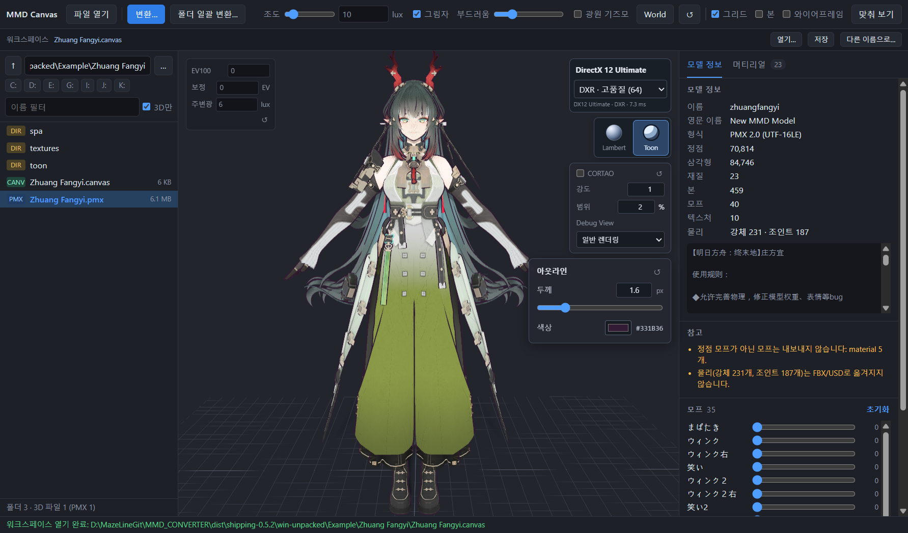
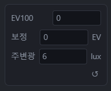
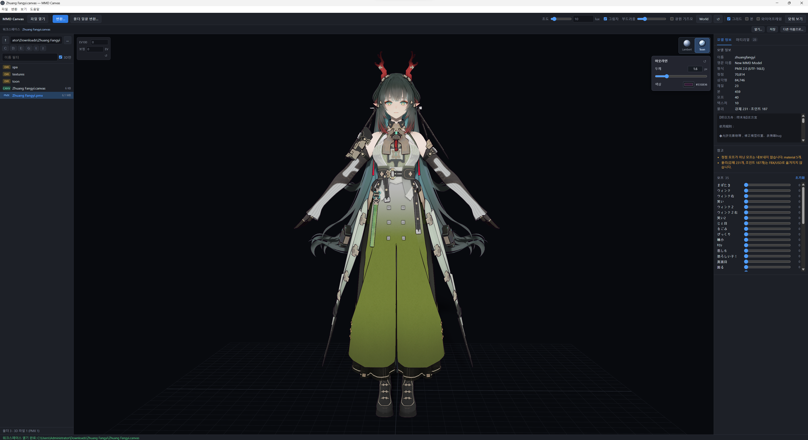

# MMD Canvas

[한국어](../README.md) · [简体中文](README.zh-CN.md) · **English** · [日本語](README.ja.md)

A desktop app for previewing PMX (MMD) models and **converting them to FBX / USD**. It combines a file browser, 3D viewer, and single-file or batch conversion. The app and CLI also use the name `MMD Converter`.



> Screenshot from v0.5.2. The installer includes the model, textures, and workspace under `Example`.

[Downloads](https://github.com/mazelines/MMD-Canvas/releases) · [CI results](https://github.com/mazelines/MMD-Canvas/actions/workflows/ci.yml) · [Release guide (Korean)](releases.md)

## v0.5.5: DLAA and DLSS

NVIDIA DLAA is the default AA, with DLSS Quality, DLSS Balanced and MSAA 4× options. Lambert and Toon reconstruct HDR color using depth and motion vectors before EV100 and GT7. DLAA/SR support RTX 20-series and newer; the app queries actual GPU/driver availability. Unsupported GPUs use DX12 MSAA 4×.

RTX 4090 tests cover background/exposure preservation, camera/pose motion, CORTAO/DXR composition and 1,200 frames of stability. Very thin geometry and transparent edges may shimmer, especially in Balanced. The installer includes NVIDIA's distribution DLL and separate SDK license. [Requirements and limitations (Korean)](dlss.md) · [0.5.5 release notes](release-notes/v0.5.5.md).

## v0.5.4: temporal DXR shadows

Lambert and Toon shadows use 1/2/4 rays, reconstructed with camera/skinning/morph motion vectors, temporal accumulation, and depth/geometric-normal-guided spatial filtering. The default is 4 rays; a 128-ray reference mode remains available. A static view accumulates up to 32 frames, then stops requesting redraws. Shadows affect direct material lighting before EV100 and GT7. [Architecture and limitations](native-dx12.md#모션-벡터와-시간-누적-그림자).

In a close-up of the bundled example, native rendering dropped from about 9.8 ms with 64 rays to 1.9 ms with 4 rays and reconstruction (RTX 4090, 1280×900). Camera/pose/disocclusion regressions and a 1,200-frame stability run passed. These timings exclude presentation; secondary transparent layers and some MSAA edges can retain fine noise. [0.5.4 release notes](release-notes/v0.5.4.md).

## v0.5.3: DXR shadow acne fix

Fix erroneous self-shadowing in Lambert and Toon. Shadow rays now start from the actual triangle's geometric normal with an offset based on position error, improving cases involving strong normal maps and changes in overall model size. Nearby shadows from thin surfaces such as clothing and hair are preserved.

GPU regression tests cover scales from 0.001 to 1,000, distant positive/negative coordinates, front/back faces, pose updates, and thin occluders. The real example completed 1,200 frames of camera movement and resizing with no GPU-process exits or outstanding frames. [Equations and validation scope](native-dx12.md#dxr-자기-교차-방지) · [0.5.3 release notes](release-notes/v0.5.3.md).

## v0.5.2: DX12 Ultimate and reliable GPU presentation

**Requires Windows 11 x64 and a DirectX 12 Ultimate GPU (feature level 12_2, DXR 1.1 or newer).** All 3D rendering uses native DX12; WebGL rendering has been removed. macOS and Linux builds are no longer distributed.

- **GPU stalls fixed:** copy DX12 output to presentation-owned GPU storage before returning the source frame. Wait when three source surfaces are still retained instead of exhausting the shared-texture pool. GPU recovery and renderer reloads are handled.
- **DXR soft shadows:** adjustable light size and 16/64/128 rays.
- **CORTAO:** applied to indirect light in the Lambert/Toon material shader before EV100 and GT7. Material AO is combined using `min(materialAO, screenAO)`. Filtered and raw AO debug views are available. [Equations and frame order](native-dx12.md#cortao-합성식).
- **Complete example and startup:** all 56 files under `Example` ship unchanged. Open `Zhuang Fangyi.canvas` when no valid previous workspace can be restored; otherwise restore the user's workspace. The bundled legacy workspace has no AO settings and opens with CORTAO disabled.

Validation covers 1,200 frames of the real example with camera movement and window resizing, delayed consumer releases, GPU-process recovery, DXR/CORTAO, and output color preservation. [Requirements and limitations](native-dx12.md) · [Release notes](release-notes/v0.5.2.md).

## v0.5.0: ambient light and EV100

The left viewport panel controls exposure and ambient fill independently.



| Setting | Effect | Default / range |
| --- | --- | --- |
| EV100 | Increasing by 1 halves display brightness without changing light illuminance. | 0 / -10–24 |
| Compensation | Each +1 EV doubles display brightness. | 0 / -10–10 EV |
| Ambient | Adds sky/ground fill to faces turned away from the directional light. Set 0 to disable it. | 2 / 0–200,000 lux |

The screenshot's 6 lux is an example setting. Double-click the ambient number field to restore 2 lux. The ↺ button resets only EV100 and compensation to 0 / 0. Directional illuminance remains a separate toolbar setting.

Ambient light is saved locally and in `.canvas`. Older workspaces without this field restore 0 lux. New saves use workspace format 2; format 1 remains readable, but older apps cannot open the new format. Use Save As if you need to preserve an older file.

Negative/decimal number entry has been improved. Background, grid, gizmo, and outline colors are compensated against exposure and tone mapping.

## What's new in v0.4.0

- **Physical lighting:** directional illuminance in lux, default 10 lux, range 0–200,000. Hidden fill lights and mode-dependent intensity multipliers have been removed.
- **Manual exposure:** EV100 (-10–24) and compensation (-10–10 EV), default 0 / 0, in the left viewport panel. Exposure does not change physical light intensity.
- **Material emission:** set reference luminance from 0 to 1,000,000 cd/m² or restore the imported-value conversion. A black emissive color remains black regardless of its reference luminance.
- **Menus and windows:** File, Convert, View, and Help menus; opening another model or workspace reuses the running window.
- **Workspace compatibility:** exposure and per-material emission persist in `.canvas`. Legacy light multipliers migrate as value × 6 lux, with the old exposure scale retained. Physical lighting can change the appearance of older scenes.

## Language and workspaces

v0.3.0 adds workspace saving/restoring and a four-language UI. Toon now uses two lighting tones, and both rendering modes use linear compositing with GT7 SDR tone mapping.

The app follows the system language at startup: **Korean, English, Simplified Chinese, or Japanese**, with English as the fallback. Model names, descriptions, and filenames remain unchanged.

Use the workspace bar to open, save, or save as a `.canvas` file. It restores the model and folder, camera, lighting, shading and outlines, material visibility, morphs, and conversion options/output paths. Folder-only batch workspaces are supported. Opening a workspace does not start conversion.

Shortcuts: `Ctrl+S` to save, `Ctrl+Shift+S` to save as, and `Ctrl+Shift+O` to open. You can also open `.canvas` files by drag and drop or as a startup argument. Assets are referenced, not embedded; preserve their relative folder structure when moving a workspace. Language is determined by the receiving system, not the workspace.

Run `npm run test:workspace` after `npm test` to verify saving/restoring and all four languages plus the English fallback in Electron.

## Features

- **Exposure and emission:** manual EV100 and compensation before GT7 (defaults 0 / 0); +1 EV100 halves brightness, +1 compensation doubles it. Set per-material emission reference luminance in cd/m². Both settings persist in `.canvas`; imported materials and export values remain intact.
- **Color pipeline:** Linear Rec.709 lighting and compositing in a half-float buffer, followed by GT7 SDR tone mapping and one sRGB output conversion. [Details (Korean)](color-pipeline.md).
- **Physical directional light:** illuminance in lux, default 10 lux; numeric range 0–200,000. Lambert uses reflectance × lux × cosine × shadow visibility / π. Double-click the slider to reset to 10 lux. No hidden fill light or mode-dependent intensity multiplier.
- **File browser:** browse drives and folders, filter by filename or 3D format, navigate with the keyboard, and drag and drop files.
- **3D viewer:** orbit, pan, zoom, frame the model, toggle grid/bones/wireframe, and control material visibility.
- **Rendering modes:** standard Lambert shading and two-tone Toon shading with adjustable outlines.
- **Toon outlines:** the native DX12 hull pass uses the posed surface normals, with adjustable width and color.
- **Animation playback:** when a loaded model carries animation clips (FBX, glTF/GLB, DAE, USD), a transport bar appears at the bottom of the viewport and playback starts. It offers play/pause, back to start, clip selection, timeline scrubbing, speed (0.25–2×), and looping; shadows and toon outlines follow the motion. PMX files contain no animation, so the bar stays hidden for them, and loading VMD motions is not supported.
- **PMX inspection:** vertex, triangle, material, bone, morph, and texture counts; model descriptions and conversion warnings; vertex morph sliders and reset.
- **Material inspector:** search material/mesh names; inspect color, opacity, roughness, metalness, texture previews, resolution, UV data, material slots, and triangle counts. View original PMX values separately. Toggle individual materials, isolate the selection, or show all, including on non-PMX models. Visibility changes affect previews only.
- **Lighting and shadows:** hardware DXR soft shadows with adjustable light size and 1/2/4-ray temporal quality (default 4), plus a 128-ray reference mode.
- **Light gizmo:** translation, rotation, Local/World coordinates, and direction reset. Lighting, shadow, direction, and coordinate-space preferences are saved.
- **Conversion:** single PMX files or entire folders, optional recursion, scale/name/morph/texture-copy options, and opening the output folder.

## Standard / simple Toon rendering

Use the **Lambert / Toon** sphere buttons at the top right of the viewport.

| Mode | Appearance | Useful for |
| --- | --- | --- |
| **Standard · Lambert** | Smooth lighting without Toon outlines; the default mode. | Inspecting shape, textures, and lighting |
| **Simple Toon** | Two lighting tones and silhouette outlines. | Previewing cel shading and character silhouettes |

Toon cast shadows share the unlit face's dark tone instead of darkening it again. Hemisphere fill is controlled by the ambient lux setting. Soft DXR shadow edges interpolate between the two tones; source texture, emission, and AO variations remain visible.



Selecting Toon reveals outline controls below the buttons:

- **Width:** slider or numeric input, 0–8px; default 1.6px. Setting 0px hides outlines while retaining Toon shading.
- **Color:** choose a color; default `#151923`.
- **Reset:** the outline panel's ↺ button restores the default width and color.
- **Persistence:** the mode and outline settings are restored on the next launch.

These modes affect viewport previews only. They do not replace original material data or turn FBX/USD exports into Toon materials. Simple Toon does not fully reproduce original MMD toon/sphere materials; custom GLSL shader materials are not supported.

> Rendering modes and the material inspector are available from `v0.2.0`.

## CORTAO contact shading

Under **CORTAO → Debug View**, `AO only` shows filtered, intensity-adjusted visibility; `Raw AO` shows the calculation before filtering and intensity. Black is occluded, white is open, and the background is gray. Lighting, textures, and exposure do not affect these views. Choose `Normal rendering` to return. Debug selection is not saved in workspaces. When CORTAO is off, the model appears white and a message explains why.

Both Lambert and Toon share the viewport's **CORTAO** controls: enabled, intensity (0–2), and radius (0.1–10% of model size). Defaults are on / 1 / 2%. CORTAO occludes ambient light in creases and contact areas; it has no effect at 0 lux ambient. Direct lighting, emission, and outlines keep their appearance.

Daniel Isheden's CORTAO 1.0.3 HLSL runs at full resolution, with 32 samples / 32 rays. It follows camera, morph, and animation changes; off-screen geometry cannot occlude the model. Settings persist between sessions and in `.canvas`. Existing GTAO settings migrate to CORTAO; workspaces with no AO settings open with it disabled. Wireframe skips CORTAO. [Implementation and license](../renderer/vendor/cortao/README.md)

## Supported formats

| Use | Formats |
| --- | --- |
| Viewer input | PMX, FBX, glTF/GLB, OBJ, STL, PLY, DAE, 3MF, USD/USDA/USDC/USDZ |
| Conversion input | PMX |
| Conversion output | FBX binary 7.4, USDA text, USDZ package |

General 3D formats use three.js loaders; extensions and material rendering may vary by file. Exporting to `.usd` writes USDA text. Binary USDC export is not implemented.

## Run

Running from source requires **Windows 11 x64, Node.js 24+, Visual Studio C++ x64 tools and Windows SDK DXC**.

The viewport uses **DirectX 12 Ultimate exclusively** on Windows 11 x64. A DX12 Ultimate GPU is required. DXR shadows, full-resolution CORTAO, MSAA and GPU shared-texture presentation run natively. Initialization errors are shown with a Retry button; there is no browser-renderer fallback. See [architecture and limitations](native-dx12.md).

```bash
npm ci
npm run build:dx12
npm start
npm start -- model.pmx    # Open a model at startup
```

The supported desktop platform is Windows 11 x64. Builds are unsigned and do not include in-app automatic updates. The native renderer requires a DX12 Ultimate GPU.

Shipping builds include every file from the local `Example` directory. Startup restores the last valid user workspace, or opens the installed `Example/Zhuang Fangyi/Zhuang Fangyi.canvas` when none is available. An explicitly opened file takes precedence. Old first-run flags do not suppress the example.

## Viewer controls

| Input | Action |
| --- | --- |
| Left drag / right drag / wheel | Orbit / pan / zoom |
| ↑ / ↓ in file list | Select and preview |
| Enter / Backspace | Enter folder / go to parent |
| F | Frame model |
| Space | Play / pause animation (models with clips) |
| Ctrl+O / Ctrl+E | Open file / convert PMX |
| W / E | Translate / rotate light gizmo |
| X or Local/World button | Switch gizmo coordinate space |
| ↺ light button | Reset light direction |
| Double-click light/softness slider | Reset that value |
| F12 | Developer tools |

Enable the light gizmo to use its shortcuts. General viewer shortcuts are inactive while entering text or while the conversion dialog is open.

## Command-line conversion

```bash
node cli.js model.pmx                                  # Write model.fbx
node cli.js model.pmx -o out/model.usda                 # Infer format from extension
node cli.js models/ -o out/ -f usdz -r                  # Recursive batch conversion
node cli.js model.pmx -n english -s 8                  # English names and scale
node cli.js model.pmx -o out/model.usdz --ascii         # ASCII USD prim names
node cli.js model.pmx --no-morphs --no-copy-textures    # Omit morphs; reference original textures
node cli.js info model.pmx                             # Model information
node cli.js --help
```

## Conversion scope and limitations

| Feature | FBX | USDA / USDZ |
| --- | --- | --- |
| Meshes, normals, UVs | Supported | Supported |
| Materials, diffuse textures | Phong | UsdPreviewSurface, GeomSubset |
| Bones, skin weights | Skin / Cluster / BindPose | UsdSkel |
| Vertex morphs and groups containing only vertex morphs | BlendShape | BlendShape |
| Physics, IK, bone/UV/material morphs, sphere/toon materials | Unsupported | Unsupported |

- Coordinates change from left-handed to right-handed Y-up, reversing Z, face winding, and UV V.
- Default scale is 8: one MMD unit becomes 8cm; output units are centimeters.
- Original names are preserved by default. English mode automatically translates standard bone names.
- SDEF / QDEF vertices become linear skinning (BDEF2 / BDEF4).
- Textures are copied to `<output-name>_textures/` or embedded in USDZ. Actual texture alpha usage is detected.
- PMD input is unsupported; convert it to PMX first.

## Tests and builds

```bash
npm test                            # Conversion, shadow, material, and shading tests
npm run test:ui                     # Run after npm test: PMX/FBX material and Toon UI checks
npm run test:workspace              # Workspace + ko/en/zh/ja + English fallback
node tests/run-tests.js --blender    # Additional import validation with Blender installed
node tests/make-heavy.js             # Dense OBJ for shadow performance checks
npm run pack                        # Unpacked application
npm run dist                        # Distributables for the current OS
```

Generated fixtures and outputs in `tests/sample/` and `tests/out/` are ignored by Git. Set `BLENDER` to the Blender executable or add it to `PATH`. Build outputs go to `dist/`.

## CI/CD

- Pushes and PRs to `main` run tests, Python syntax checks, native DX12 compilation and packaging checks on Windows. Run `npm run test:dx12` locally on a DX12 Ultimate GPU.
- Pushing a `v*` tag validates the version and builds four platform/architecture packages. Once all succeed, the workflow publishes a GitHub Release with SHA-256 checksums.
- **Actions → Release → Run workflow**, with a branch selected, builds artifacts without publishing a release.
- Dependabot checks npm and GitHub Actions updates weekly.

On a release branch, run `npm version patch --no-git-tag-version`, commit `package.json` and `package-lock.json`, and merge through a PR after CI passes. Create and push a `vX.Y.Z` tag matching the package version on the merged `main` commit to publish. See the [release guide (Korean)](releases.md).

## Project structure

Built with JavaScript (ES modules), Electron, three.js, and HTML/CSS. Blender import validation uses Python.

```text
src/core/             PMX parser, scene normalization, FBX/USD writers, conversion pipeline
electron/             Main process, preload, file access, IPC
renderer/             Browser, viewer, DXR shadows, light gizmo, materials, Toon shading
cli.js                Command-line converter
tests/                PMX/OBJ generators, core/UI tests, Blender validation
.github/workflows/    CI and release automation
electron-builder.yml  Platform packaging configuration
docs/                 Screenshots, translated READMEs, release guide
```

## License

Code is released under the [MIT License](../LICENSE). Models and textures loaded by users remain subject to their creators' terms.

The GT7 reference implementation notice is in [GT7-MIT.txt](../licenses/GT7-MIT.txt) and is included in distribution packages.
