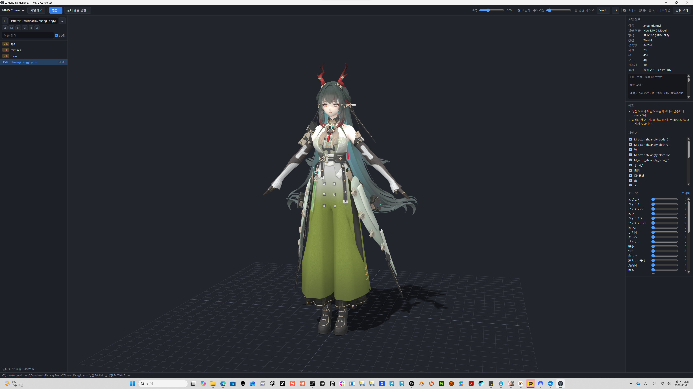
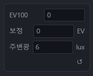
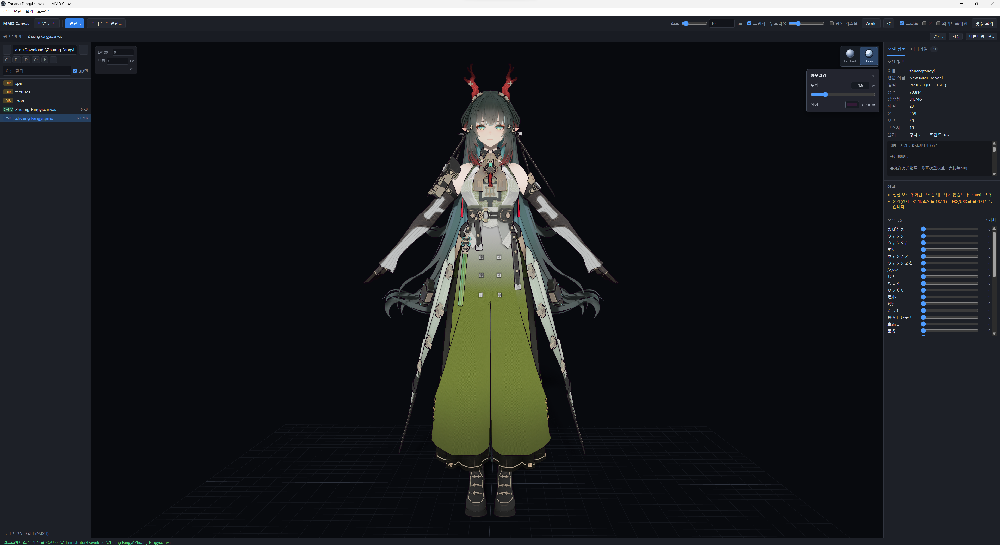

# MMD Canvas

[한국어](../README.md) · [简体中文](README.zh-CN.md) · [English](README.en.md) · **日本語**

PMX（MMD）モデルをプレビューし、**FBX / USD に変換**するデスクトップアプリです。ファイルブラウザー、3D ビューアー、単一ファイル・一括変換を一つの画面で利用できます。アプリ内と CLI では `MMD Converter` という名前も使用しています。



> スクリーンショットは v0.2.0 の機能を紹介しています。サンプルモデルはリポジトリに含まれません。

[ダウンロード](https://github.com/mazelines/MMD-Canvas/releases) · [CI 結果](https://github.com/mazelines/MMD-Canvas/actions/workflows/ci.yml) · [リリースガイド（韓国語）](releases.md)

## v0.5.0：環境光と EV100

ビューポート左側のパネルで露出と環境光を個別に調整します。



| 設定 | 動作 | 初期値 / 範囲 |
| --- | --- | --- |
| EV100 | 1 増やすと画面の明るさが半分になります。光源の lux は変わりません。 | 0 / -10–24 |
| 補正 | +1 EV ごとに画面の明るさが2倍になります。 | 0 / -10–10 EV |
| 環境光 | 平行光が当たらない面に空・地面からの補助光を加えます。0 で無効になります。 | 2 / 0–200,000 lux |

画像の 6 lux は設定例です。環境光の数値欄をダブルクリックすると 2 lux に戻ります。↺ ボタンは EV100 と補正だけを 0 / 0 に戻します。平行光の照度は上部ツールバーで別途設定します。

環境光はローカル設定と `.canvas` に保存されます。環境光項目のない旧ファイルは 0 lux で復元します。保存形式はバージョン2になり、バージョン1も読み込めますが、旧アプリでは新形式を開けません。旧ファイルを残す場合は別名で保存してください。

負数・小数の入力を改善し、背景・グリッド・ギズモ・アウトラインの色を露出とトーンマッピングに対して補正しました。

## v0.4.0 の更新

- **物理照明**：平行光の照度を lux で指定します。初期値は 10 lux、範囲は 0–200,000。自動補助光とモード別の光量倍率を廃止しました。
- **手動露出**：ビューポート左側で EV100（-10–24）と露出補正（-10–10 EV）を調整します。初期値は 0 / 0 で、物理的な光量は変更しません。
- **材質の発光**：基準輝度を 0–1,000,000 cd/m² に設定し、元の値からの換算値に戻せます。発光色が黒の場合、基準輝度を上げても明るくなりません。
- **メニューとウィンドウ**：ファイル・変換・表示・ヘルプのメニューを追加しました。別のモデルやワークスペースを開くと、起動中のウィンドウを再利用します。
- **互換性**：露出と材質ごとの発光設定を `.canvas` に保存します。旧光量倍率は「値 × 6 lux」に変換し、旧露出倍率を維持します。物理照明の導入により、以前のシーンとは明るさが異なる場合があります。

## 表示言語とワークスペース

ビューポート左側で GT7 適用前の手動 EV100 と露出補正を調整できます（初期値 0 / 0）。EV100 +1 で明るさが半分、補正 +1 EV で2倍になります。マテリアルパネルで発光の基準輝度を cd/m² 単位で設定でき、露出と発光設定は `.canvas` に保存されます。元のマテリアルと出力データは維持します。

v0.3.0 ではワークスペースの保存・復元と4言語 UI を追加しました。Toon は2段階の陰影に変更し、両モードで線形合成と GT7 SDR トーンマッピングを使用します。

起動時にシステム言語を判定し、**韓国語・英語・簡体字中国語・日本語**で表示します。その他の言語では英語を使用します。モデルの名前・説明やファイル名は変更しません。

上部のワークスペースバーから `.canvas` ファイルを開く・保存・別名で保存できます。モデルとフォルダー、カメラ、照明、描画モードと輪郭線、マテリアルの表示状態、モーフ、変換オプションと出力先を復元します。モデルなしでフォルダーと一括変換設定のみを保存することもできます。開いただけでは変換は実行されません。

ショートカットは `Ctrl+S` が保存、`Ctrl+Shift+S` が別名で保存、`Ctrl+Shift+O` が開くです（macOS は `Cmd`）。ドラッグ＆ドロップや起動引数でも開けます。モデルやテクスチャは埋め込まず、パスで参照します。移動する際は相対的なフォルダー構成を維持してください。表示言語はワークスペースに保存せず、使用するシステムに従います。

`npm test` の後に `npm run test:workspace` を実行すると、保存・復元、4言語と英語へのフォールバックを検証できます。

## 機能

- **ファイルブラウザー**：ドライブ・フォルダーの参照、名前による絞り込み、3D ファイルのみの表示、キーボード操作、ドラッグ＆ドロップ。
- **3D ビューアー**：視点の回転・平行移動・拡大縮小、モデル全体の表示、グリッド・ボーン・ワイヤーフレーム表示、マテリアルごとの表示切り替え。
- **レンダリングモード**：標準 Lambert とシンプル Toon。Toon は2段階の陰影と調整可能なアウトラインを表示します。
- **スムーズ法線のアウトライン**：同じ位置の頂点を実行時にまとめ、面の角度で重み付けした法線で UV シームやハードエッジをつなぎます。元の表面法線を保持し、追加のパッキング用チャンネルは不要です。初回の Toon 切り替え時に計算し、頂点・モーフの変更時だけ再計算して、それ以外のフレームでは再利用します。
- **PMX 情報**：頂点・三角形・材質・ボーン・モーフ・テクスチャの数、モデル説明、変換時の警告、頂点モーフのスライダーとリセット。
- **マテリアル情報**：材質・メッシュ名の検索、色・不透明度・ラフネス・メタルネス、テクスチャのプレビュー・拡大・解像度・UV、使用スロットと三角形数を確認できます。PMX の元の値も別途表示します。一般形式のモデルでも個別表示・選択のみ表示・すべて表示に対応します。表示設定はプレビューにのみ適用されます。
- **照明と影**：光の強さ、PCSS ソフトシャドウ、光源サイズによる柔らかさを調整できます。モデルに合わせた 4096 × 4096 のシャドウマップを使い、モデル・材質・光源の変更時に更新します。
- **光源ギズモ**：移動・回転、Local/World 座標切り替え、方向のリセット。照明・影・光源方向・座標系の設定を保存します。
- **変換**：単一 PMX またはフォルダーの一括変換、サブフォルダーの再帰処理、スケール・名前・モーフ・テクスチャコピーの設定、出力フォルダーを開く操作。

## 標準 / シンプル Toon レンダリング

ビューポートは半精度浮動小数点バッファーで Linear Rec.709 の照明計算と合成を行い、最後に GT7 SDR トーンマッピングと一度だけの sRGB 出力変換を適用します。[技術説明（韓国語）](color-pipeline.md)。

平行光の照度は lux で入力し、初期値は **10 lux**、数値範囲は 0–200,000 です。Lambert は「反射率 × 照度 × 入射角の余弦 × 影の可視率 / π」で輝度を計算します。スライダーのダブルクリックで 10 lux に戻り、暗黙の補助光やモード別の光量倍率は適用しません。

ビューポート右上の球アイコン **Lambert / Toon** で切り替えます。

| モード | 表現 | 用途 |
| --- | --- | --- |
| **標準 · Lambert** | 連続した柔らかい陰影。Toon アウトラインは非表示。初期選択モードです。 | 形状・テクスチャ・照明の確認 |
| **シンプル Toon** | 2段階の陰影とモデルの輪郭線。 | キャラクターのセル調表現やシルエットの確認 |

Toon の投影された影は陰の面と同じ暗いトーンを使用し、重なってもさらに暗くしません。半球補助光は環境光の lux 設定で調整します。PCSS の柔らかい境界は2つのトーン間を補間し、元のテクスチャ・発光・AO による変化は維持します。



Toon を選択すると、ボタンの下にアウトライン設定が表示されます。

- **太さ**：スライダーまたは数値入力で 0–8px に調整できます。初期値は 1.6px。0px にすると Toon の陰影を保ったまま輪郭線だけを非表示にします。
- **色**：カラーピッカーで変更します。初期値は `#151923` です。
- **リセット**：アウトライン設定の ↺ ボタンで太さと色を初期値に戻します。
- **設定の保持**：モードとアウトライン設定は次回起動時にも復元されます。

切り替えはビューポートのプレビューにのみ適用され、元のマテリアル情報や FBX/USD 出力を Toon 材質に変更しません。シンプル Toon は MMD 本来のトゥーン・スフィア材質を完全に再現する機能ではありません。カスタムシェーダー材質は独自の描画方式を維持します。

> レンダリングモードとマテリアルパネルは `v0.2.0` から利用できます。

## 対応形式

| 用途 | 形式 |
| --- | --- |
| ビューアー入力 | PMX、FBX、glTF/GLB、OBJ、STL、PLY、DAE、3MF、USD/USDA/USDC/USDZ |
| 変換入力 | PMX |
| 変換出力 | FBX バイナリ 7.4、USDA テキスト、USDZ パッケージ |

一般的な 3D 形式は three.js ローダーを使用するため、拡張機能や材質表現はファイルによって異なる場合があります。`.usd` 出力は USDA テキストです。USDC バイナリ出力は未実装です。

## 起動

ソースからの実行には **Node.js 24 以降と npm** が必要です。

```bash
npm ci
npm start
npm start -- model.pmx    # 指定したモデルを開く
```

Windows x64 インストーラー、macOS Apple Silicon/Intel ZIP、Linux x64 AppImage を配布します。現在のビルドは未署名で、アプリ内自動更新機能はありません。

## ビューアー操作

| 操作 | 機能 |
| --- | --- |
| 左ドラッグ / 右ドラッグ / ホイール | 視点の回転 / 平行移動 / 拡大縮小 |
| ファイル一覧で ↑ / ↓ | 選択とプレビュー |
| Enter / Backspace | フォルダーに入る / 親フォルダーへ |
| F | モデル全体を表示 |
| Ctrl+O / Ctrl+E | ファイルを開く / PMX を変換 |
| W / E | 光源ギズモの移動 / 回転 |
| X または Local/World ボタン | ギズモの座標系を切り替え |
| 光源の ↺ ボタン | 光源方向をリセット |
| 照明・柔らかさスライダーをダブルクリック | 該当する値をリセット |
| F12 | 開発者ツール |

光源のショートカットを使うには光源ギズモを有効にしてください。文字入力中や変換ダイアログを開いている間は、通常のビューアーショートカットは動作しません。

## コマンドライン変換

```bash
node cli.js model.pmx                                  # model.fbx を出力
node cli.js model.pmx -o out/model.usda                 # 拡張子から形式を選択
node cli.js models/ -o out/ -f usdz -r                  # サブフォルダーも一括変換
node cli.js model.pmx -n english -s 8                  # 英語名とスケールを指定
node cli.js model.pmx -o out/model.usdz --ascii         # USD prim 名を ASCII に制限
node cli.js model.pmx --no-morphs --no-copy-textures    # モーフを除外し元のテクスチャを参照
node cli.js info model.pmx                             # モデル情報
node cli.js --help
```

## 変換範囲と制限

| 項目 | FBX | USDA / USDZ |
| --- | --- | --- |
| メッシュ・法線・UV | 対応 | 対応 |
| 材質・ディフューズテクスチャ | Phong | UsdPreviewSurface、GeomSubset |
| ボーン・スキンウェイト | Skin / Cluster / BindPose | UsdSkel |
| 頂点モーフと頂点モーフのみを含むグループ | BlendShape | BlendShape |
| 物理・IK・ボーン/UV/材質モーフ・スフィア/トゥーン材質 | 非対応 | 非対応 |

- 左手系から右手系 Y-up に変換し、Z 軸・面の向き・UV V を反転します。
- 初期スケールは 8。MMD の1単位を 8cm として扱い、出力単位は cm です。
- 初期設定では元の名前を保持します。英語モードでは標準ボーン名を自動翻訳します。
- SDEF / QDEF 頂点は線形スキニング（BDEF2 / BDEF4）に変換します。
- テクスチャは `<出力名>_textures/` にコピーし、USDZ ではパッケージに含めます。実際のアルファ使用状況を判定します。
- PMD 入力には対応していません。先に PMX に変換してください。

## テストとビルド

```bash
npm test                            # 変換・影・材質・シェーディングのテスト
npm run test:ui                     # npm test 後に実行：PMX/FBX 材質と Toon UI の検証
npm run test:workspace              # Workspace + ko/en/zh/ja + English fallback
node tests/run-tests.js --blender    # Blender 導入済みの場合の追加インポート検証
node tests/make-heavy.js             # 影の性能確認用の高密度 OBJ を生成
npm run pack                        # 展開済みアプリを生成
npm run dist                        # 現在の OS 向け配布ファイルを生成
```

テスト入出力は `tests/sample/` と `tests/out/` に生成され、Git では無視されます。Blender 実行ファイルは `BLENDER` 環境変数で指定するか `PATH` に登録してください。ビルド出力先は `dist/` です。

## CI/CD

- `main` への push と PR で、Windows・macOS・Linux のテスト、Python 構文チェック、アプリのパッケージングを検証します。
- `v*` タグを push するとバージョンを検証し、4種類のプラットフォーム・アーキテクチャ向けにビルドします。すべて成功すると GitHub Release に配布物と SHA-256 チェックサムを公開します。
- **Actions → Release → Run workflow** でブランチを選ぶと、リリースを公開せず成果物のみを生成します。
- Dependabot が npm と GitHub Actions の更新を毎週確認します。

リリースブランチで `npm version patch --no-git-tag-version` を実行し、`package.json` と `package-lock.json` をコミットします。CI 通過後に PR をマージし、マージ済みの `main` コミットにパッケージバージョンと一致する `vX.Y.Z` タグを付けて push します。詳細は[リリースガイド（韓国語）](releases.md)を参照してください。

## 構成

JavaScript（ES modules）、Electron、three.js、HTML/CSS を使用しています。Blender のインポート検証は Python で実装しています。

```text
src/core/             PMX パーサー、シーン正規化、FBX/USD 出力、変換処理
electron/             メインプロセス、preload、ファイルアクセス、IPC
renderer/             ブラウザー、ビューアー、PCSS、光源ギズモ、材質、Toon
cli.js                コマンドライン変換
tests/                PMX/OBJ 生成、コア・UI テスト、Blender 検証
.github/workflows/    CI とリリース自動化
electron-builder.yml  OS 別パッケージング設定
docs/                 スクリーンショット、多言語 README、リリースガイド
```

## ライセンス

コードは [MIT License](../LICENSE) に基づきます。読み込むモデルやテクスチャには、それぞれの制作者の利用条件が適用されます。

GT7 参照実装の MIT 表記は [GT7-MIT.txt](../licenses/GT7-MIT.txt) にあり、配布パッケージにも含まれます。
