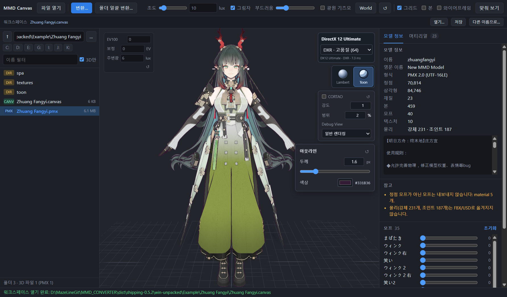
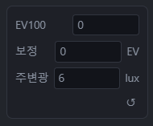
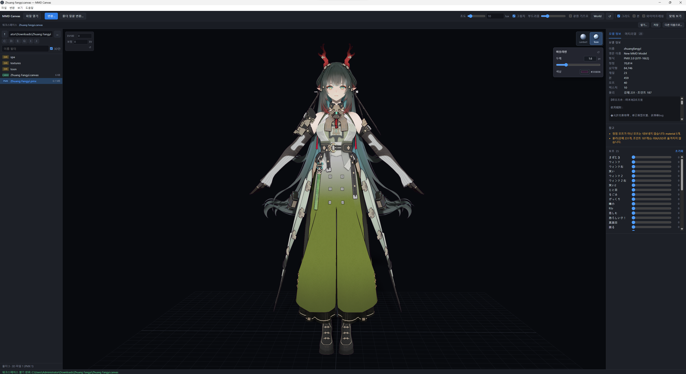

# MMD Canvas

[한국어](../README.md) · [简体中文](README.zh-CN.md) · [English](README.en.md) · **日本語**

PMX（MMD）モデルをプレビューし、**FBX / USD に変換**するデスクトップアプリです。ファイルブラウザー、3D ビューアー、単一ファイル・一括変換を一つの画面で利用できます。アプリ内と CLI では `MMD Converter` という名前も使用しています。



> v0.5.2 の実行画面です。`Example` のモデル・テクスチャ・ワークスペースをインストーラーに同梱します。

[ダウンロード](https://github.com/mazelines/MMD-Canvas/releases) · [CI 結果](https://github.com/mazelines/MMD-Canvas/actions/workflows/ci.yml) · [リリースガイド（韓国語）](releases.md)

## v0.5.4：時間蓄積 DXR シャドウ

Lambert・Toon の影を 1・2・4 本のレイで計算し、カメラ・スキニング・モーフのモーションベクトル、時間蓄積、深度・幾何法線に基づく空間フィルターで復元します。既定は 4 本で、比較用の 128 本の参照モードも利用できます。静止時は最大 32 フレームを蓄積してから再描画を停止します。影は EV100・GT7 より前にマテリアルの直接光へ適用します。[構成と制限](native-dx12.md#모션-벡터와-시간-누적-그림자)。

同梱サンプルの近接表示では、ネイティブ描画時間が 64 本のレイで約 9.8ms から、4 本と復元処理で約 1.9ms に短縮しました（RTX 4090、1280×900）。カメラ・ポーズ・遮蔽解除の回帰テストと 1,200 フレームの安定性検証を通過しました。この時間には画面転送を含みません。重なった透明レイヤーや一部の MSAA 境界には細かなノイズが残る場合があります。[0.5.4 リリースノート](release-notes/v0.5.4.md)。

## v0.5.3：DXR の shadow acne を修正

Lambert・Toon で表面が誤って自分自身を遮る自己交差を修正しました。実際の三角形の幾何法線と位置誤差に基づいてシャドウレイの始点を補正し、強い法線マップやモデル全体のサイズによる誤判定を改善します。衣装や髪など、近接する薄い面の影も保持します。

0.001～1,000 倍のスケール、正負の遠距離座標、表裏、ポーズ変更、薄い遮蔽物の GPU 回帰テストを通過しました。実際のサンプルによるカメラ移動・リサイズ 1,200 フレームで、GPU プロセスの終了や未返却フレームはありませんでした。[計算式と検証範囲](native-dx12.md#dxr-자기-교차-방지) · [0.5.3 リリースノート](release-notes/v0.5.3.md)。

## v0.5.2：DX12 Ultimate と GPU 表示の安定化

**Windows 11 x64 と DirectX 12 Ultimate 対応 GPU（feature level 12_2、DXR 1.1 以上）が必要です。** 3D 描画をネイティブ DX12 に統一し、WebGL 描画を削除しました。macOS・Linux 向けビルドは提供しません。

- **表示の停止を修正：** DX12 出力を表示用の GPU 表面へコピーしてから元のフレームを返却します。未返却の表面が 3 枚ある場合は次の描画要求を待機させ、共有テクスチャの枯渇を防ぎます。GPU 接続の復旧と画面の再読み込みにも対応します。
- **DXR ソフトシャドウ：** 光源サイズと 16・64・128 rays の品質設定。
- **CORTAO：** Lambert・Toon のマテリアルシェーダー内で間接光へ適用し、その後 EV100・GT7 を処理します。マテリアル AO とは `min(materialAO, screenAO)` で合成します。フィルター後・Raw AO のデバッグ表示に対応します。
- **サンプルと起動：** `Example` の全 56 ファイルをそのまま同梱します。有効な前回の作業があれば復元し、それ以外は `Zhuang Fangyi.canvas` を開きます。同梱の旧形式ワークスペースには AO 設定がないため、CORTAO は無効で開きます。

実際のサンプルを使ったカメラ移動・ウィンドウサイズ変更の 1,200 フレーム、遅延したフレーム返却、GPU プロセス復旧、DXR・CORTAO・色の保持を検証しています。[構成と制限](native-dx12.md) · [リリースノート](release-notes/v0.5.2.md)。

## v0.5.0：環境光と EV100

ビューポート左側のパネルで露出と環境光を個別に調整します。



| 設定 | 動作 | 初期値 / 範囲 |
| --- | --- | --- |
| EV100 | 1 増やすと画面の明るさが半分になります。光源の lux は変わりません。 | 0 / -10–24 |
| 補正 | +1 EV ごとに画面の明るさが2倍になります。 | 0 / -10–10 EV |
| 環境光 | 平行光が当たらない面に空・地面からの補助光を加えます。0 で無効になります。 | 2 / 0–200,000 lux |

画像の 6 lux は設定例です。環境光の数値欄をダブルクリックすると 2 lux に戻ります。↺ ボタンは EV100 と補正だけを 0 / 0 に戻します。平行光の照度は上部ツールバーで別途設定します。

環境光はローカル設定と `.canvas` に保存されます。環境光項目のない旧ファイルは 0 lux で復元します。保存形式はバージョン2になり、バージョン1も読み込めますが、旧アプリでは新形式を開けません。旧ファイルを残す場合は別名で保存してください。

負数・小数の入力を改善し、背景・グリッド・ギズモ・アウトラインの色を露出とトーンマッピングに対して補正しました。

## v0.4.0 の更新

- **物理照明**：平行光の照度を lux で指定します。初期値は 10 lux、範囲は 0–200,000。自動補助光とモード別の光量倍率を廃止しました。
- **手動露出**：ビューポート左側で EV100（-10–24）と露出補正（-10–10 EV）を調整します。初期値は 0 / 0 で、物理的な光量は変更しません。
- **材質の発光**：基準輝度を 0–1,000,000 cd/m² に設定し、元の値からの換算値に戻せます。発光色が黒の場合、基準輝度を上げても明るくなりません。
- **メニューとウィンドウ**：ファイル・変換・表示・ヘルプのメニューを追加しました。別のモデルやワークスペースを開くと、起動中のウィンドウを再利用します。
- **互換性**：露出と材質ごとの発光設定を `.canvas` に保存します。旧光量倍率は「値 × 6 lux」に変換し、旧露出倍率を維持します。物理照明の導入により、以前のシーンとは明るさが異なる場合があります。

## 表示言語とワークスペース

ビューポート左側で GT7 適用前の手動 EV100 と露出補正を調整できます（初期値 0 / 0）。EV100 +1 で明るさが半分、補正 +1 EV で2倍になります。マテリアルパネルで発光の基準輝度を cd/m² 単位で設定でき、露出と発光設定は `.canvas` に保存されます。元のマテリアルと出力データは維持します。

v0.3.0 ではワークスペースの保存・復元と4言語 UI を追加しました。Toon は2段階の陰影に変更し、両モードで線形合成と GT7 SDR トーンマッピングを使用します。

起動時にシステム言語を判定し、**韓国語・英語・簡体字中国語・日本語**で表示します。その他の言語では英語を使用します。モデルの名前・説明やファイル名は変更しません。

上部のワークスペースバーから `.canvas` ファイルを開く・保存・別名で保存できます。モデルとフォルダー、カメラ、照明、描画モードと輪郭線、マテリアルの表示状態、モーフ、変換オプションと出力先を復元します。モデルなしでフォルダーと一括変換設定のみを保存することもできます。開いただけでは変換は実行されません。

ショートカットは `Ctrl+S` が保存、`Ctrl+Shift+S` が別名で保存、`Ctrl+Shift+O` が開くです。ドラッグ＆ドロップや起動引数でも開けます。モデルやテクスチャは埋め込まず、パスで参照します。移動する際は相対的なフォルダー構成を維持してください。表示言語はワークスペースに保存せず、使用するシステムに従います。

`npm test` の後に `npm run test:workspace` を実行すると、保存・復元、4言語と英語へのフォールバックを検証できます。

## 機能

- **ファイルブラウザー**：ドライブ・フォルダーの参照、名前による絞り込み、3D ファイルのみの表示、キーボード操作、ドラッグ＆ドロップ。
- **3D ビューアー**：視点の回転・平行移動・拡大縮小、モデル全体の表示、グリッド・ボーン・ワイヤーフレーム表示、マテリアルごとの表示切り替え。
- **レンダリングモード**：標準 Lambert とシンプル Toon。Toon は2段階の陰影と調整可能なアウトラインを表示します。
- **Toon アウトライン**：DX12 のハルパスで、ポーズを反映した表面法線を使って描画します。太さと色を調整できます。
- **アニメーション再生**：読み込んだモデルにアニメーションクリップがある場合（FBX・glTF/GLB・DAE・USD）、ビューポート下部に再生バーが表示され、再生が始まります。再生・一時停止、先頭に戻る、クリップ選択、タイムラインのシーク、速度（0.25–2×）、ループに対応し、影とトゥーン輪郭線も動きに追従します。PMX ファイルにはアニメーションが含まれないため再生バーは表示されず、VMD モーションの読み込みには対応していません。
- **PMX 情報**：頂点・三角形・材質・ボーン・モーフ・テクスチャの数、モデル説明、変換時の警告、頂点モーフのスライダーとリセット。
- **マテリアル情報**：材質・メッシュ名の検索、色・不透明度・ラフネス・メタルネス、テクスチャのプレビュー・拡大・解像度・UV、使用スロットと三角形数を確認できます。PMX の元の値も別途表示します。一般形式のモデルでも個別表示・選択のみ表示・すべて表示に対応します。表示設定はプレビューにのみ適用されます。
- **照明と影**：DXR ハードウェアソフトシャドウを使います。光源サイズと時間蓄積の品質（1/2/4 rays、既定 4）を調整でき、128 rays の参照モードも利用できます。
- **光源ギズモ**：移動・回転、Local/World 座標切り替え、方向のリセット。照明・影・光源方向・座標系の設定を保存します。
- **変換**：単一 PMX またはフォルダーの一括変換、サブフォルダーの再帰処理、スケール・名前・モーフ・テクスチャコピーの設定、出力フォルダーを開く操作。

## 標準 / シンプル Toon レンダリング

ビューポートは半精度浮動小数点バッファーで Linear Rec.709 の照明計算と合成を行い、最後に GT7 SDR トーンマッピングと一度だけの sRGB 出力変換を適用します。[技術説明（韓国語）](color-pipeline.md)。

平行光の照度は lux で入力し、初期値は **10 lux**、数値範囲は 0–200,000 です。Lambert は「反射率 × 照度 × 入射角の余弦 × 影の可視率 / π」で輝度を計算します。スライダーのダブルクリックで 10 lux に戻り、暗黙の補助光やモード別の光量倍率は適用しません。

ビューポート右上の球アイコン **Lambert / Toon** で切り替えます。

| モード | 表現 | 用途 |
| --- | --- | --- |
| **標準 · Lambert** | 連続した柔らかい陰影。Toon アウトラインは非表示。初期選択モードです。 | 形状・テクスチャ・照明の確認 |
| **シンプル Toon** | 2段階の陰影とモデルの輪郭線。 | キャラクターのセル調表現やシルエットの確認 |

Toon の投影された影は陰の面と同じ暗いトーンを使用し、重なってもさらに暗くしません。半球補助光は環境光の lux 設定で調整します。DXR の柔らかい境界は2つのトーン間を補間し、元のテクスチャ・発光・AO による変化は維持します。



Toon を選択すると、ボタンの下にアウトライン設定が表示されます。

- **太さ**：スライダーまたは数値入力で 0–8px に調整できます。初期値は 1.6px。0px にすると Toon の陰影を保ったまま輪郭線だけを非表示にします。
- **色**：カラーピッカーで変更します。初期値は `#151923` です。
- **リセット**：アウトライン設定の ↺ ボタンで太さと色を初期値に戻します。
- **設定の保持**：モードとアウトライン設定は次回起動時にも復元されます。

切り替えはビューポートのプレビューにのみ適用され、元のマテリアル情報や FBX/USD 出力を Toon 材質に変更しません。シンプル Toon は MMD 本来のトゥーン・スフィア材質を完全に再現する機能ではありません。カスタム GLSL シェーダー材質には対応していません。

> レンダリングモードとマテリアルパネルは `v0.2.0` から利用できます。

## CORTAO による接触部分の陰影

**CORTAO → Debug View** の `AO のみ` はフィルターと強度を適用した遮蔽量、`フィルター前 AO` は計算直後の値を表示します。黒は遮蔽、白は開放、背景は灰色です。照明・テクスチャ・露出の影響を受けません。`通常の描画` で戻ります。デバッグ表示はワークスペースに保存されません。CORTAO がオフの場合はモデルが白く表示され、説明文が出ます。

Lambert と Toon は右側の **CORTAO** 設定を共有します。オン/オフ、強度（0–2）、範囲（モデルの大きさの 0.1–10%）を調節できます。初期値はオン・強度 1・範囲 2% です。隙間や接触部分の環境光を抑えるため、環境光が 0 lux の場合は効果がありません。直接光・発光・アウトラインは維持します。

Daniel Isheden の CORTAO 1.0.3 HLSL をフル解像度・32 samples / 32 rays で計算します。カメラ・モーフ・アニメーションの変化に追従し、画面外の形状による遮蔽は計算しません。設定は次回の起動と `.canvas` に保存します。既存の GTAO 設定は CORTAO に移行し、AO 設定自体のない旧ワークスペースでは無効にします。ワイヤーフレームでは計算を省略します。[実装とライセンス](../renderer/vendor/cortao/README.md)

## 対応形式

| 用途 | 形式 |
| --- | --- |
| ビューアー入力 | PMX、FBX、glTF/GLB、OBJ、STL、PLY、DAE、3MF、USD/USDA/USDC/USDZ |
| 変換入力 | PMX |
| 変換出力 | FBX バイナリ 7.4、USDA テキスト、USDZ パッケージ |

一般的な 3D 形式は three.js ローダーを使用するため、拡張機能や材質表現はファイルによって異なる場合があります。`.usd` 出力は USDA テキストです。USDC バイナリ出力は未実装です。

## 起動

ソースからの実行には **Windows 11 x64、Node.js 24 以降、Visual Studio C++ x64 ツールと Windows SDK DXC** が必要です。

**Windows 11 x64 / DirectX 12 Ultimate 専用**です。対応 GPU が必要です。DXR、フル解像度 CORTAO、MSAA、GPU 共有テクスチャ表示をネイティブで処理します。初期化に失敗した場合はエラーと再試行ボタンを表示し、別のレンダラーには切り替えません。[構成と制限](native-dx12.md)。

```bash
npm ci
npm run build:dx12
npm start
npm start -- model.pmx    # 指定したモデルを開く
```

対応デスクトップ環境は Windows 11 x64 です。ネイティブ描画には DX12 Ultimate GPU が必要です。現在のビルドは未署名で、アプリ内自動更新機能はありません。

## ビューアー操作

| 操作 | 機能 |
| --- | --- |
| 左ドラッグ / 右ドラッグ / ホイール | 視点の回転 / 平行移動 / 拡大縮小 |
| ファイル一覧で ↑ / ↓ | 選択とプレビュー |
| Enter / Backspace | フォルダーに入る / 親フォルダーへ |
| F | モデル全体を表示 |
| Space | アニメーションの再生 / 一時停止（クリップのあるモデル） |
| Ctrl+O / Ctrl+E | ファイルを開く / PMX を変換 |
| W / E | 光源ギズモの移動 / 回転 |
| X または Local/World ボタン | ギズモの座標系を切り替え |
| 光源の ↺ ボタン | 光源方向をリセット |
| 照明・柔らかさスライダーをダブルクリック | 該当する値をリセット |
| F12 | 開発者ツール |

光源のショートカットを使うには光源ギズモを有効にしてください。文字入力中や変換ダイアログを開いている間は、通常のビューアーショートカットは動作しません。

## コマンドライン変換

```bash
node cli.js model.pmx                                  # model.fbx を出力
node cli.js model.pmx -o out/model.usda                 # 拡張子から形式を選択
node cli.js models/ -o out/ -f usdz -r                  # サブフォルダーも一括変換
node cli.js model.pmx -n english -s 8                  # 英語名とスケールを指定
node cli.js model.pmx -o out/model.usdz --ascii         # USD prim 名を ASCII に制限
node cli.js model.pmx --no-morphs --no-copy-textures    # モーフを除外し元のテクスチャを参照
node cli.js info model.pmx                             # モデル情報
node cli.js --help
```

## 変換範囲と制限

| 項目 | FBX | USDA / USDZ |
| --- | --- | --- |
| メッシュ・法線・UV | 対応 | 対応 |
| 材質・ディフューズテクスチャ | Phong | UsdPreviewSurface、GeomSubset |
| ボーン・スキンウェイト | Skin / Cluster / BindPose | UsdSkel |
| 頂点モーフと頂点モーフのみを含むグループ | BlendShape | BlendShape |
| 物理・IK・ボーン/UV/材質モーフ・スフィア/トゥーン材質 | 非対応 | 非対応 |

- 左手系から右手系 Y-up に変換し、Z 軸・面の向き・UV V を反転します。
- 初期スケールは 8。MMD の1単位を 8cm として扱い、出力単位は cm です。
- 初期設定では元の名前を保持します。英語モードでは標準ボーン名を自動翻訳します。
- SDEF / QDEF 頂点は線形スキニング（BDEF2 / BDEF4）に変換します。
- テクスチャは `<出力名>_textures/` にコピーし、USDZ ではパッケージに含めます。実際のアルファ使用状況を判定します。
- PMD 入力には対応していません。先に PMX に変換してください。

## テストとビルド

```bash
npm test                            # 変換・影・材質・シェーディングのテスト
npm run test:ui                     # npm test 後に実行：PMX/FBX 材質と Toon UI の検証
npm run test:workspace              # Workspace + ko/en/zh/ja + English fallback
node tests/run-tests.js --blender    # Blender 導入済みの場合の追加インポート検証
node tests/make-heavy.js             # 影の性能確認用の高密度 OBJ を生成
npm run pack                        # 展開済みアプリを生成
npm run dist                        # 現在の OS 向け配布ファイルを生成
```

テスト入出力は `tests/sample/` と `tests/out/` に生成され、Git では無視されます。Blender 実行ファイルは `BLENDER` 環境変数で指定するか `PATH` に登録してください。ビルド出力先は `dist/` です。

## CI/CD

- `main` への push と PR で、Windows のテスト、Python 構文、DX12 コンパイルとパッケージングを検証します。`npm run test:dx12` は対応 GPU で実行します。
- `v*` タグを push するとバージョンを検証し、4種類のプラットフォーム・アーキテクチャ向けにビルドします。すべて成功すると GitHub Release に配布物と SHA-256 チェックサムを公開します。
- **Actions → Release → Run workflow** でブランチを選ぶと、リリースを公開せず成果物のみを生成します。
- Dependabot が npm と GitHub Actions の更新を毎週確認します。

リリースブランチで `npm version patch --no-git-tag-version` を実行し、`package.json` と `package-lock.json` をコミットします。CI 通過後に PR をマージし、マージ済みの `main` コミットにパッケージバージョンと一致する `vX.Y.Z` タグを付けて push します。詳細は[リリースガイド（韓国語）](releases.md)を参照してください。

## 構成

JavaScript（ES modules）、Electron、three.js、HTML/CSS を使用しています。Blender のインポート検証は Python で実装しています。

```text
src/core/             PMX パーサー、シーン正規化、FBX/USD 出力、変換処理
electron/             メインプロセス、preload、ファイルアクセス、IPC
renderer/             ブラウザー、ビューアー、DXR、光源ギズモ、材質、Toon
cli.js                コマンドライン変換
tests/                PMX/OBJ 生成、コア・UI テスト、Blender 検証
.github/workflows/    CI とリリース自動化
electron-builder.yml  OS 別パッケージング設定
docs/                 スクリーンショット、多言語 README、リリースガイド
```

## ライセンス

コードは [MIT License](../LICENSE) に基づきます。読み込むモデルやテクスチャには、それぞれの制作者の利用条件が適用されます。

GT7 参照実装の MIT 表記は [GT7-MIT.txt](../licenses/GT7-MIT.txt) にあり、配布パッケージにも含まれます。
