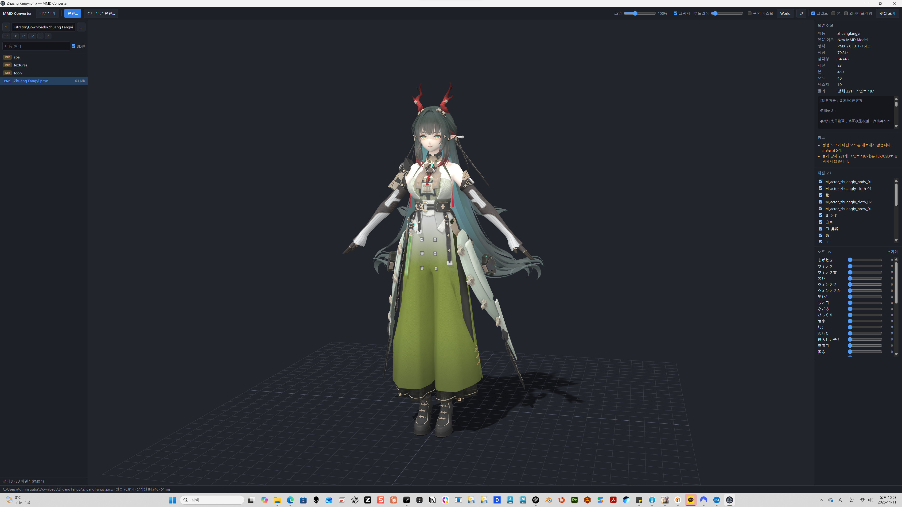
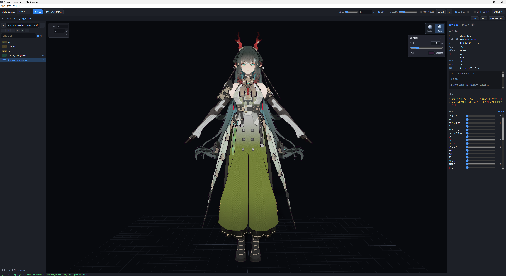

# MMD Canvas

[한국어](../README.md) · **简体中文** · [English](README.en.md) · [日本語](README.ja.md)

用于预览 PMX（MMD）模型并将其**转换为 FBX / USD** 的桌面应用。集文件浏览、3D 预览、单文件转换和批量转换于一体。应用内部及 CLI 也使用 `MMD Converter` 名称。



> 截图展示 v0.2.0 的功能。仓库不包含示例模型文件。

[下载](https://github.com/mazelines/MMD-Canvas/releases) · [CI 结果](https://github.com/mazelines/MMD-Canvas/actions/workflows/ci.yml) · [发布指南（韩语）](releases.md)

## 界面语言与工作区

v0.3.0 新增工作区保存与恢复及四语言界面。Toon 改为两档明暗，两种渲染模式均采用线性合成和 GT7 SDR 色调映射。

应用启动时自动使用系统语言，支持**韩语、英语、简体中文和日语**；其他语言使用英语。模型名称、说明和文件名保持原样。

通过顶部工作区栏打开、保存或另存为 `.canvas` 文件，可恢复模型与文件夹、相机、灯光、渲染模式与描边、材质可见性、变形权重，以及转换选项和输出路径。也支持仅保存文件夹和批量转换设置。打开工作区不会自动执行转换。

快捷键：`Ctrl+S` 保存，`Ctrl+Shift+S` 另存为，`Ctrl+Shift+O` 打开（macOS 使用 `Cmd`）。也可拖入 `.canvas` 文件或通过启动参数打开。文件只引用资源路径，不嵌入模型或纹理；移动时请保持相对文件夹结构。界面语言不随工作区保存，而是跟随当前系统。

先运行 `npm test`，再运行 `npm run test:workspace`，可验证保存、恢复、四种语言和英语回退。

## 功能

- **文件浏览器**：浏览驱动器与文件夹，按文件名筛选，仅显示 3D 文件，支持键盘导航和拖放。
- **3D 查看器**：旋转、平移、缩放视角，适配模型，显示网格、骨骼和线框，按材质控制可见性。
- **渲染模式**：标准 Lambert 模式和简易 Toon 模式。Toon 提供两档明暗及可调描边。
- **平滑法线描边**：运行时将位置相同的顶点分组，计算按面角度加权的法线，连接 UV 接缝与硬边。保留原始表面法线，无需额外打包通道。首次启用 Toon 时计算结果，仅在顶点或变形发生变化时重新计算，其余帧复用缓存。
- **PMX 检查**：显示顶点、三角形、材质、骨骼、变形和纹理数量，以及模型说明、转换警告、顶点变形滑块和重置按钮。
- **材质检查**：搜索材质或网格名称，查看颜色、不透明度、粗糙度、金属度、纹理预览与放大、分辨率、UV、使用槽位及三角形数量。单独显示 PMX 原始值。普通模型同样支持单独显示、仅显示选中项和显示全部。可见性设置仅影响预览。
- **光照与阴影**：调整光照强度及 PCSS 柔和阴影的光源大小。使用适配模型的 4096 × 4096 阴影贴图，在模型、材质或光源变化时更新。
- **光源操纵器**：移动、旋转，切换 Local/World 坐标系，重置方向。保存光照、阴影、光源方向和坐标系设置。
- **转换**：单个 PMX 或文件夹批量转换，支持递归子文件夹、缩放、命名、变形、纹理复制选项及打开输出目录。

## 标准 / 简易 Toon 渲染

视口在半浮点缓冲区中以 Linear Rec.709 进行光照与合成，最后应用 GT7 SDR 色调映射和一次 sRGB 输出转换。[技术说明（韩语）](color-pipeline.md)。

点击视口右上角的 **Lambert / Toon** 球形图标切换模式。

| 模式 | 表现 | 用途 |
| --- | --- | --- |
| **标准 · Lambert** | 连续柔和的明暗，无 Toon 描边；默认模式。 | 检查模型形状、纹理和光照 |
| **简易 Toon** | 两档明暗和模型轮廓描边。 | 预览角色的卡通着色和轮廓 |

Toon 的投射阴影与背光面使用相同暗色调，不会重复压暗；半球补光保持恒定。PCSS 柔和边缘在两档明暗之间插值，保留原材质的纹理、自发光和 AO 变化。



选择 Toon 后，按钮下方会出现描边设置：

- **宽度**：用滑块或数值输入调节，范围 0–8px，默认 1.6px。设为 0px 时仅隐藏描边，保留 Toon 明暗。
- **颜色**：通过颜色选择器调整，默认 `#151923`。
- **重置**：描边面板的 ↺ 按钮恢复默认宽度和颜色。
- **设置保存**：下次启动时恢复渲染模式和描边设置。

模式切换仅影响视口预览，不会改写原始材质信息，也不会将 FBX/USD 导出结果转换为 Toon 材质。简易 Toon 并不完整复现 MMD 原有的 toon/sphere 材质；自定义着色器材质保留自身的渲染方式。

> 渲染模式与材质面板从 `v0.2.0` 起提供。

## 支持的格式

| 用途 | 格式 |
| --- | --- |
| 预览输入 | PMX、FBX、glTF/GLB、OBJ、STL、PLY、DAE、3MF、USD/USDA/USDC/USDZ |
| 转换输入 | PMX |
| 转换输出 | FBX 二进制 7.4、USDA 文本、USDZ 包 |

通用 3D 格式使用 three.js 加载器，不同文件的扩展功能和材质显示可能存在差异。导出为 `.usd` 时写入的是 USDA 文本，尚不支持 USDC 二进制输出。

## 运行

从源码运行需要 **Node.js 24 或更高版本及 npm**。

```bash
npm ci
npm start
npm start -- model.pmx    # 启动时打开指定模型
```

提供 Windows x64 安装程序、macOS Apple Silicon/Intel ZIP 和 Linux x64 AppImage。当前构建未签名，不含应用内自动更新功能。

## 操作

| 输入 | 功能 |
| --- | --- |
| 鼠标左键拖动 / 右键拖动 / 滚轮 | 旋转 / 平移 / 缩放视角 |
| 文件列表中的 ↑ / ↓ | 选择并预览 |
| Enter / Backspace | 进入文件夹 / 返回上级 |
| F | 适配模型 |
| Ctrl+O / Ctrl+E | 打开文件 / 转换 PMX |
| W / E | 光源操纵器移动 / 旋转模式 |
| X 或 Local/World 按钮 | 切换操纵器坐标系 |
| 光源 ↺ 按钮 | 重置光源方向 |
| 双击光照或柔和度滑块 | 重置对应值 |
| F12 | 开发者工具 |

需启用光源操纵器才能使用其快捷键。输入文字或打开转换对话框时，常规视口快捷键不生效。

## 命令行转换

```bash
node cli.js model.pmx                                  # 输出 model.fbx
node cli.js model.pmx -o out/model.usda                 # 根据扩展名选择格式
node cli.js models/ -o out/ -f usdz -r                  # 递归批量转换
node cli.js model.pmx -n english -s 8                  # 英文名称和缩放比例
node cli.js model.pmx -o out/model.usdz --ascii         # USD prim 名称限制为 ASCII
node cli.js model.pmx --no-morphs --no-copy-textures    # 排除变形，引用原始纹理
node cli.js info model.pmx                             # 输出模型信息
node cli.js --help
```

## 转换范围与限制

| 项目 | FBX | USDA / USDZ |
| --- | --- | --- |
| 网格、法线、UV | 支持 | 支持 |
| 材质、漫反射纹理 | Phong | UsdPreviewSurface、GeomSubset |
| 骨骼、蒙皮权重 | Skin / Cluster / BindPose | UsdSkel |
| 顶点变形及仅包含顶点变形的组合 | BlendShape | BlendShape |
| 物理、IK、骨骼/UV/材质变形、sphere/toon 材质 | 不支持 | 不支持 |

- 从左手坐标系转换到右手 Y-up，反转 Z、面绕序和 UV V。
- 默认缩放为 8，即 1 个 MMD 单位对应 8cm，输出单位为厘米。
- 默认保留原始名称；英文模式自动翻译标准骨骼名称。
- SDEF / QDEF 顶点转换为线性蒙皮（BDEF2 / BDEF4）。
- 纹理复制到 `<输出名称>_textures/`，USDZ 则将纹理包含在包中。检测纹理实际使用的透明度。
- 不支持 PMD 输入，请先转换为 PMX。

## 测试与构建

```bash
npm test                            # 转换、阴影、材质和着色测试
npm run test:ui                     # npm test 后运行：PMX/FBX 材质与 Toon UI 测试
npm run test:workspace              # Workspace + ko/en/zh/ja + English fallback
node tests/run-tests.js --blender    # 安装 Blender 后进行附加导入验证
node tests/make-heavy.js             # 生成用于阴影性能测试的高密度 OBJ
npm run pack                        # 生成未打包的应用目录
npm run dist                        # 生成当前操作系统的分发文件
```

测试输入和输出生成在 `tests/sample/`、`tests/out/`，由 Git 忽略。通过 `BLENDER` 环境变量指定 Blender 可执行文件，或将其加入 `PATH`。构建结果位于 `dist/`。

## CI/CD

- 向 `main` 推送或提交 PR 时，在 Windows、macOS、Linux 上执行测试、Python 语法检查和应用打包检查。
- 推送 `v*` 标签后验证版本并构建四种平台/架构分发文件。全部成功后发布 GitHub Release 和 SHA-256 校验和。
- 在 **Actions → Release → Run workflow** 中选择分支，可仅构建产物而不发布版本。
- Dependabot 每周检查 npm 依赖与 GitHub Actions 更新。

在发布分支运行 `npm version patch --no-git-tag-version`，提交 `package.json` 和 `package-lock.json`，待 CI 通过后通过 PR 合并。在已合并的 `main` 提交上创建并推送与包版本一致的 `vX.Y.Z` 标签即可发布。详情参见[发布指南（韩语）](releases.md)。

## 项目结构

使用 JavaScript（ES modules）、Electron、three.js 和 HTML/CSS。Blender 导入验证使用 Python。

```text
src/core/             PMX 解析、场景规范化、FBX/USD 输出、转换流程
electron/             主进程、preload、文件访问、IPC
renderer/             浏览器、查看器、PCSS 阴影、光源操纵器、材质和 Toon 着色
cli.js                命令行转换器
tests/                PMX/OBJ 生成器、核心与 UI 测试、Blender 验证
.github/workflows/    CI 与发布自动化
electron-builder.yml  平台打包配置
docs/                 截图、多语言 README、发布指南
```

## 许可证

代码采用 [MIT License](../LICENSE)。用户加载的模型和纹理仍受其作者的使用条款约束。

GT7 参考实现的 MIT 声明见 [GT7-MIT.txt](../licenses/GT7-MIT.txt)，分发包中也包含此文件。
