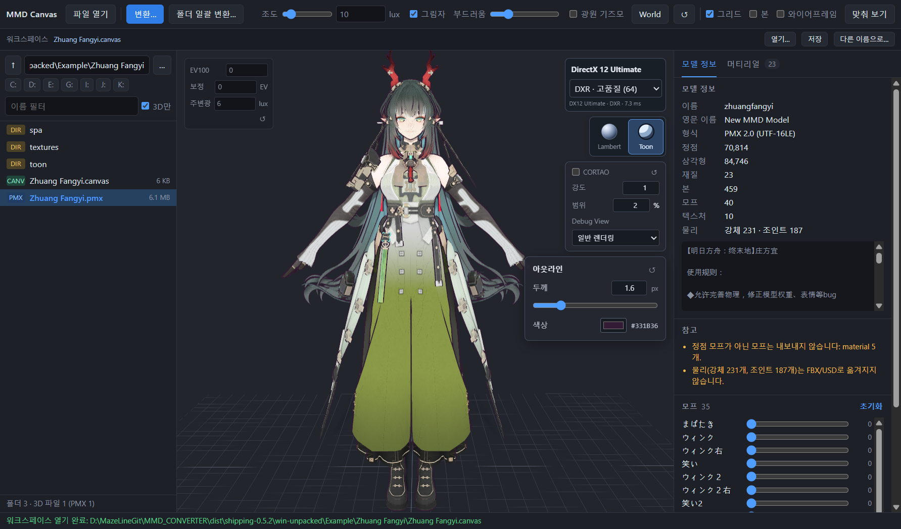
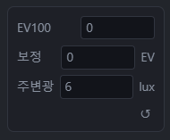
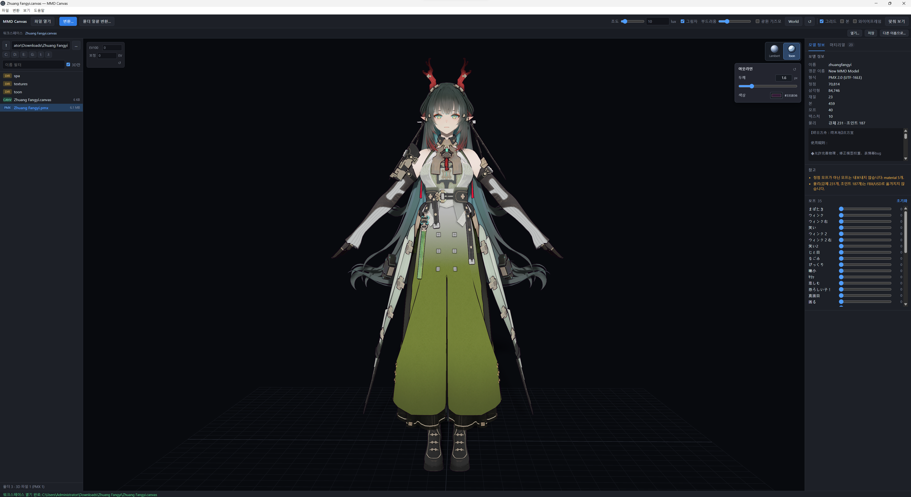

# MMD Canvas

[한국어](../README.md) · **简体中文** · [English](README.en.md) · [日本語](README.ja.md)

用于预览 PMX（MMD）模型并将其**转换为 FBX / USD** 的桌面应用。集文件浏览、3D 预览、单文件转换和批量转换于一体。应用内部及 CLI 也使用 `MMD Converter` 名称。



> v0.5.2 运行截图。安装包包含 `Example` 中的模型、纹理和工作区。

[下载](https://github.com/mazelines/MMD-Canvas/releases) · [CI 结果](https://github.com/mazelines/MMD-Canvas/actions/workflows/ci.yml) · [发布指南（韩语）](releases.md)

## v0.6.1：基于深度的边缘光（DepthRimLight）

新增参考 miHoYo 系二次元游戏深度边缘光技法的 DepthRimLight 示例函数。不用菲涅尔，而是沿光源方向采样屏幕空间相邻深度，检测轮廓（深度不连续）并应用边缘光。为此向着色器堆栈添加了屏幕空间深度采样助手（sampleSceneDepth）及 viewportSize/lightDirScreen 上下文字段。可通过属性调节宽度、深度阈值、过渡、强度、颜色。[结构与语法](shader-stack.md) · [0.6.1 发布说明](release-notes/v0.6.1.md)。

## v0.6.0：Unreal 风格着色器编辑器与材质预览

将着色器堆栈编辑器重新设计为 Unreal 材质编辑器风格的工作画布：中央渲染材质球预览（轨道相机），右侧堆栈层支持拖放排序。通过层边界的 + 弹窗在层间插入函数，用 Del 或右键菜单删除。预览由独立的第二个 DX12 主机渲染；应用的堆栈同时更新球体预览和主角色视口。[结构与语法](shader-stack.md) · [0.6.0 发布说明](release-notes/v0.6.0.md)。

## v0.5.9：着色器堆栈恢复加固

修复打开带着色器堆栈的工作区时，DX12 渲染器尚未就绪或编译错误不再中断工作区恢复。堆栈状态保留在主进程并在渲染器启动时应用。解决 v0.5.8 首次启动工作区路径报告回归。[0.5.9 发布说明](release-notes/v0.5.9.md)。

## v0.5.8：着色器堆栈编辑器独立窗口

将着色器堆栈编辑器从检查器标签页移至**独立的编辑窗口**，通过**视图 → 着色器堆栈编辑器…**（Ctrl+Shift+K）打开。关闭窗口后堆栈状态保留，重新打开时恢复。窗口无预览，应用结果显示在主视口。主进程管理堆栈状态并串行化渲染通道，使着色器加载不与进行中的渲染冲突。[结构与语法](shader-stack.md) · [0.5.8 发布说明](release-notes/v0.5.8.md)。

## v0.5.7：着色器堆栈编辑器

新增**着色器堆栈**检查器标签页，可通过堆叠自己编写的 HLSL 函数来扩展已加载 PMX 角色的表面着色。它基于代码编辑而非节点图：内置光照保持为固定基础，你按顺序添加 `void fn(inout ShadingContext ctx)` 层。用 `//@property` 注释声明的参数会根据堆栈内容自动生成 UI 控件，修改数值无需重新编译。

函数使用随附的 DXC 在运行时编译并热替换原生 color PSO；空的默认堆栈与之前的着色逐位一致。附带 RimLight、Fresnel、ColorGrade、ToonRamp 示例以及工作区保存/恢复。安装包包含 DXC（Windows SDK 可再发行组件）和 CodeMirror（MIT）。[结构与语法](shader-stack.md) · [0.5.7 发布说明](release-notes/v0.5.7.md)。

## v0.5.6：网格质量与 NVIDIA 锐化

修复低视角下网格线断裂、闪烁的问题。根据地面的投影大小，在输出分辨率下过滤线条，对远处密集的线条进行淡出，并平滑网格边界。网格默认关闭，首次启动的内置画布也采用该设置。半透明材质在材质列表中使用黄色复选框。

新增 NVIDIA NIS NVSharpen，可在 DLAA、DLSS 和 MSAA 下将最终画面的锐化强度调整为 0–100%，默认 25%。设置保存在本机，0% 时跳过锐化步骤。锐化可能放大残留的时域波动。[实现与限制（韩语）](dlss.md) · [0.5.6 发布说明](release-notes/v0.5.6.md)。

## v0.5.5：DLAA 与 DLSS

默认抗锯齿改为 NVIDIA DLAA，并可选择 DLSS Quality、DLSS Balanced 或 MSAA 4×。Lambert 和 Toon 均使用深度、运动向量，在 EV100、GT7 之前重建 HDR 颜色。DLAA/SR 支持 RTX 20 系列及更新型号，应用会查询实际 GPU 与驱动支持情况。不支持的 GPU 使用 DX12 MSAA 4×。

RTX 4090 验证覆盖背景与曝光保持、相机与姿态移动、CORTAO/DXR 合成及 1,200 帧稳定性。极细几何和透明边缘仍可能闪烁，Balanced 模式更明显。安装包包含 NVIDIA 发布版 DLL 及单独的 SDK 许可证。[硬件要求与限制（韩语）](dlss.md) · [0.5.5 发布说明](release-notes/v0.5.5.md)。

## v0.5.4：时域累积 DXR 阴影

Lambert、Toon 阴影使用 1、2、4 条光线计算，通过相机、蒙皮及变形的运动向量、时域累积，以及深度和几何法线引导的空间滤波重建。默认使用 4 条光线，另提供 128 条光线的参考模式。静止画面最多累积 32 帧，随后停止请求重绘。阴影在 EV100、GT7 之前作用于材质的直接光。[结构与限制](native-dx12.md#모션-벡터와-시간-누적-그림자)。

在内置示例的近距离画面中，原生渲染时间从 64 条光线的约 9.8ms 降至 4 条光线加重建的约 1.9ms（RTX 4090，1280×900）。相机、姿态变化及遮挡解除回归测试和 1,200 帧稳定性验证均通过。该时间不含画面传输；重叠透明层及部分 MSAA 边界仍可能有细微噪点。[0.5.4 发布说明](release-notes/v0.5.4.md)。

## v0.5.3：修复 DXR shadow acne

修复 Lambert、Toon 模式中表面错误遮挡自身的自相交问题。阴影光线现在根据实际三角形的几何法线和位置误差调整起点，改善强法线贴图或模型整体尺寸变化引起的误判，同时保留衣物、头发等邻近薄面的阴影。

GPU 回归测试覆盖 0.001～1,000 倍缩放、远处正负坐标、正反面、姿态更新及薄遮挡物。实际示例完成相机移动和窗口缩放共 1,200 帧，未出现 GPU 进程退出或未归还帧。[计算公式与验证范围](native-dx12.md#dxr-자기-교차-방지) · [0.5.3 发布说明](release-notes/v0.5.3.md)。

## v0.5.2：DX12 Ultimate 与 GPU 显示稳定性

**需要 Windows 11 x64 和支持 DirectX 12 Ultimate 的 GPU（feature level 12_2、DXR 1.1 或更高）。** 所有 3D 渲染统一使用原生 DX12，已移除 WebGL 渲染。不再提供 macOS、Linux 安装包。

- **修复画面停顿：** 先将 DX12 输出复制到显示端拥有的 GPU 表面，再归还原始帧。如果已有 3 个表面等待归还，就暂停提交新的渲染请求，避免共享纹理池耗尽。同时处理 GPU 连接恢复和界面重新加载。
- **DXR 软阴影：** 可调整光源大小，并选择 16、64、128 rays。
- **CORTAO：** 在 Lambert、Toon 材质着色器中作用于间接光，然后再执行 EV100 和 GT7。材质 AO 使用 `min(materialAO, screenAO)` 合成，并提供过滤后及 Raw AO 调试视图。
- **完整示例与启动：** 原样打包 `Example` 下的全部 56 个文件。优先恢复有效的用户工作区，否则打开 `Zhuang Fangyi.canvas`。内置旧格式工作区没有 AO 设置，因此打开时 CORTAO 处于关闭状态。

已验证实际示例的相机移动、窗口缩放共 1,200 帧，以及延迟归还帧、GPU 进程恢复、DXR、CORTAO 和输出颜色保持。[结构与限制](native-dx12.md) · [发布说明](release-notes/v0.5.2.md)。

## v0.5.0：环境光与 EV100

在视口左侧面板中分别调整曝光和环境补光。



| 设置 | 效果 | 默认值 / 范围 |
| --- | --- | --- |
| EV100 | 每增加 1，画面亮度减半，不改变光源的 lux。 | 0 / -10–24 |
| 补偿 | 每增加 +1 EV，画面亮度加倍。 | 0 / -10–10 EV |
| 环境光 | 为平行光照不到的表面添加天空与地面补光，设为 0 可关闭。 | 2 / 0–200,000 lux |

图片中的 6 lux 是设置示例。双击环境光数值框可恢复 2 lux。↺ 按钮只将 EV100 和补偿重置为 0 / 0。平行光照度仍在顶部工具栏单独设置。

环境光保存于本地设置及 `.canvas` 文件。缺少环境光字段的旧工作区按 0 lux 恢复。新保存文件采用版本 2，仍能读取版本 1，但旧应用无法打开新格式。需要保留旧文件时请使用“另存为”。

改进了负数与小数输入，并补偿背景、网格、操纵器和描边颜色受到的曝光与色调映射影响。

## v0.4.0 更新

- **物理光照**：以 lux 设置平行光照度，默认 10 lux，范围 0–200,000。移除了自动补光和随模式变化的光强倍率。
- **手动曝光**：在视口左侧调整 EV100（-10–24）和曝光补偿（-10–10 EV），默认 0 / 0。曝光不改变物理光强。
- **材质自发光**：参考亮度可设为 0–1,000,000 cd/m²，也可恢复原始值的换算结果。自发光颜色为黑色时，仅提高参考亮度不会使其发亮。
- **菜单与窗口**：新增文件、转换、视图和帮助菜单。打开另一个模型或工作区时复用正在运行的窗口。
- **工作区兼容性**：曝光与各材质的自发光设置保存在 `.canvas` 中。旧光照倍率按「数值 × 6 lux」转换，并保留旧曝光倍率。引入物理光照后，旧场景的显示亮度可能发生变化。

## 界面语言与工作区

视口左侧提供 GT7 之前的手动 EV100 与曝光补偿，默认值为 0 / 0；EV100 +1 使亮度减半，补偿 +1 EV 使亮度加倍。材质面板可设置以 cd/m² 表示的自发光参考亮度。曝光与材质发光设置保存在 `.canvas` 中，不修改原始材质和导出数据。

v0.3.0 新增工作区保存与恢复及四语言界面。Toon 改为两档明暗，两种渲染模式均采用线性合成和 GT7 SDR 色调映射。

应用启动时自动使用系统语言，支持**韩语、英语、简体中文和日语**；其他语言使用英语。模型名称、说明和文件名保持原样。

通过顶部工作区栏打开、保存或另存为 `.canvas` 文件，可恢复模型与文件夹、相机、灯光、渲染模式与描边、材质可见性、变形权重，以及转换选项和输出路径。也支持仅保存文件夹和批量转换设置。打开工作区不会自动执行转换。

快捷键：`Ctrl+S` 保存，`Ctrl+Shift+S` 另存为，`Ctrl+Shift+O` 打开。也可拖入 `.canvas` 文件或通过启动参数打开。文件只引用资源路径，不嵌入模型或纹理；移动时请保持相对文件夹结构。界面语言不随工作区保存，而是跟随当前系统。

先运行 `npm test`，再运行 `npm run test:workspace`，可验证保存、恢复、四种语言和英语回退。

## 功能

- **文件浏览器**：浏览驱动器与文件夹，按文件名筛选，仅显示 3D 文件，支持键盘导航和拖放。
- **3D 查看器**：旋转、平移、缩放视角，适配模型，显示网格、骨骼和线框，按材质控制可见性。
- **渲染模式**：标准 Lambert 模式和简易 Toon 模式。Toon 提供两档明暗及可调描边。
- **Toon 描边**：在 DX12 外壳通道中使用当前姿势的表面法线绘制，可调整宽度与颜色。
- **动画播放**：加载的模型带有动画片段时（FBX、glTF/GLB、DAE、USD），视口底部会显示播放栏并开始播放。支持播放/暂停、回到开头、片段选择、时间轴拖动、速度（0.25–2×）和循环，阴影与卡通描边会跟随动作。PMX 文件不包含动画，因此不会显示播放栏；不支持加载 VMD 动作。
- **PMX 检查**：显示顶点、三角形、材质、骨骼、变形和纹理数量，以及模型说明、转换警告、顶点变形滑块和重置按钮。
- **材质检查**：搜索材质或网格名称，查看颜色、不透明度、粗糙度、金属度、纹理预览与放大、分辨率、UV、使用槽位及三角形数量。单独显示 PMX 原始值。普通模型同样支持单独显示、仅显示选中项和显示全部。可见性设置仅影响预览。
- **光照与阴影**：使用 DXR 硬件软阴影，可调整光源大小和时域累积质量（1/2/4 条光线，默认 4），另提供 128 条光线的参考模式。
- **光源操纵器**：移动、旋转，切换 Local/World 坐标系，重置方向。保存光照、阴影、光源方向和坐标系设置。
- **转换**：单个 PMX 或文件夹批量转换，支持递归子文件夹、缩放、命名、变形、纹理复制选项及打开输出目录。

## 标准 / 简易 Toon 渲染

视口在半浮点缓冲区中以 Linear Rec.709 进行光照与合成，最后应用 GT7 SDR 色调映射和一次 sRGB 输出转换。[技术说明（韩语）](color-pipeline.md)。

平行光照度以 lux 输入，默认 **10 lux**，数值范围为 0–200,000。Lambert 使用「反射率 × 照度 × 入射角余弦 × 阴影可见度 / π」计算亮度。双击滑块恢复 10 lux，不添加隐式补光或按模式调整光强。

点击视口右上角的 **Lambert / Toon** 球形图标切换模式。

| 模式 | 表现 | 用途 |
| --- | --- | --- |
| **标准 · Lambert** | 连续柔和的明暗，无 Toon 描边；默认模式。 | 检查模型形状、纹理和光照 |
| **简易 Toon** | 两档明暗和模型轮廓描边。 | 预览角色的卡通着色和轮廓 |

Toon 的投射阴影与背光面使用相同暗色调，不会重复压暗；半球补光通过环境光 lux 设置控制。DXR 柔和边缘在两档明暗之间插值，保留原材质的纹理、自发光和 AO 变化。



选择 Toon 后，按钮下方会出现描边设置：

- **宽度**：用滑块或数值输入调节，范围 0–8px，默认 1.6px。设为 0px 时仅隐藏描边，保留 Toon 明暗。
- **颜色**：通过颜色选择器调整，默认 `#151923`。
- **重置**：描边面板的 ↺ 按钮恢复默认宽度和颜色。
- **设置保存**：下次启动时恢复渲染模式和描边设置。

模式切换仅影响视口预览，不会改写原始材质信息，也不会将 FBX/USD 导出结果转换为 Toon 材质。简易 Toon 并不完整复现 MMD 原有的 toon/sphere 材质；不支持自定义 GLSL 着色器材质。

> 渲染模式与材质面板从 `v0.2.0` 起提供。

## CORTAO 接触阴影

在 **CORTAO → Debug View** 中，`仅 AO` 显示应用滤波和强度后的遮蔽量，`滤波前 AO` 显示计算原始值。黑色表示遮蔽，白色表示开放，背景为灰色，不受光照、纹理和曝光影响。选择 `正常渲染` 返回。调试视图不保存到工作区。CORTAO 关闭时模型显示为白色，并出现说明文字。

Lambert 和 Toon 共用视口右侧的 **CORTAO** 设置：开关、强度（0–2）和范围（模型尺寸的 0.1–10%）。默认开启，强度为 1，范围为 2%。CORTAO 减少缝隙和接触处的环境光；环境光为 0 lux 时没有效果。直射光、自发光和轮廓线保持原有表现。

使用 Daniel Isheden 的 CORTAO 1.0.3 HLSL，以全分辨率、32 samples / 32 rays 计算，并随相机、变形和动画更新。无法计算屏幕外几何体造成的遮蔽。设置会保存到下次启动和 `.canvas` 文件。现有 GTAO 设置迁移到 CORTAO；完全没有 AO 设置的旧工作区默认关闭。线框模式下跳过计算。[实现与许可证](../renderer/vendor/cortao/README.md)

## 支持的格式

| 用途 | 格式 |
| --- | --- |
| 预览输入 | PMX、FBX、glTF/GLB、OBJ、STL、PLY、DAE、3MF、USD/USDA/USDC/USDZ |
| 转换输入 | PMX |
| 转换输出 | FBX 二进制 7.4、USDA 文本、USDZ 包 |

通用 3D 格式使用 three.js 加载器，不同文件的扩展功能和材质显示可能存在差异。导出为 `.usd` 时写入的是 USDA 文本，尚不支持 USDC 二进制输出。

## 运行

从源码运行需要 **Windows 11 x64、Node.js 24+、Visual Studio C++ x64 工具和 Windows SDK DXC**。

**仅支持 Windows 11 x64 / DirectX 12 Ultimate**，需要兼容 GPU。DXR、全分辨率 CORTAO、MSAA 与 GPU 共享纹理显示均由原生渲染器处理。初始化失败时显示错误与重试按钮，不会切换到其他渲染器。[架构与限制](native-dx12.md)。

```bash
npm ci
npm run build:dx12
npm start
npm start -- model.pmx    # 启动时打开指定模型
```

支持的桌面平台为 Windows 11 x64，原生渲染需要 DX12 Ultimate GPU。当前构建未签名，不含应用内自动更新功能。

## 操作

| 输入 | 功能 |
| --- | --- |
| 鼠标左键拖动 / 右键拖动 / 滚轮 | 旋转 / 平移 / 缩放视角 |
| 文件列表中的 ↑ / ↓ | 选择并预览 |
| Enter / Backspace | 进入文件夹 / 返回上级 |
| F | 适配模型 |
| Space | 播放 / 暂停动画（带片段的模型） |
| Ctrl+O / Ctrl+E | 打开文件 / 转换 PMX |
| W / E | 光源操纵器移动 / 旋转模式 |
| X 或 Local/World 按钮 | 切换操纵器坐标系 |
| 光源 ↺ 按钮 | 重置光源方向 |
| 双击光照或柔和度滑块 | 重置对应值 |
| F12 | 开发者工具 |

需启用光源操纵器才能使用其快捷键。输入文字或打开转换对话框时，常规视口快捷键不生效。

## 命令行转换

```bash
node cli.js model.pmx                                  # 输出 model.fbx
node cli.js model.pmx -o out/model.usda                 # 根据扩展名选择格式
node cli.js models/ -o out/ -f usdz -r                  # 递归批量转换
node cli.js model.pmx -n english -s 8                  # 英文名称和缩放比例
node cli.js model.pmx -o out/model.usdz --ascii         # USD prim 名称限制为 ASCII
node cli.js model.pmx --no-morphs --no-copy-textures    # 排除变形，引用原始纹理
node cli.js info model.pmx                             # 输出模型信息
node cli.js --help
```

## 转换范围与限制

| 项目 | FBX | USDA / USDZ |
| --- | --- | --- |
| 网格、法线、UV | 支持 | 支持 |
| 材质、漫反射纹理 | Phong | UsdPreviewSurface、GeomSubset |
| 骨骼、蒙皮权重 | Skin / Cluster / BindPose | UsdSkel |
| 顶点变形及仅包含顶点变形的组合 | BlendShape | BlendShape |
| 物理、IK、骨骼/UV/材质变形、sphere/toon 材质 | 不支持 | 不支持 |

- 从左手坐标系转换到右手 Y-up，反转 Z、面绕序和 UV V。
- 默认缩放为 8，即 1 个 MMD 单位对应 8cm，输出单位为厘米。
- 默认保留原始名称；英文模式自动翻译标准骨骼名称。
- SDEF / QDEF 顶点转换为线性蒙皮（BDEF2 / BDEF4）。
- 纹理复制到 `<输出名称>_textures/`，USDZ 则将纹理包含在包中。检测纹理实际使用的透明度。
- 不支持 PMD 输入，请先转换为 PMX。

## 测试与构建

```bash
npm test                            # 转换、阴影、材质和着色测试
npm run test:ui                     # npm test 后运行：PMX/FBX 材质与 Toon UI 测试
npm run test:workspace              # Workspace + ko/en/zh/ja + English fallback
node tests/run-tests.js --blender    # 安装 Blender 后进行附加导入验证
node tests/make-heavy.js             # 生成用于阴影性能测试的高密度 OBJ
npm run pack                        # 生成未打包的应用目录
npm run dist                        # 生成当前操作系统的分发文件
```

测试输入和输出生成在 `tests/sample/`、`tests/out/`，由 Git 忽略。通过 `BLENDER` 环境变量指定 Blender 可执行文件，或将其加入 `PATH`。构建结果位于 `dist/`。

## CI/CD

- 向 `main` 推送或提交 PR 时，在 Windows 上验证测试、Python 语法、DX12 编译和应用打包。`npm run test:dx12` 需要本地兼容 GPU。
- 推送 `v*` 标签后验证版本并构建四种平台/架构分发文件。全部成功后发布 GitHub Release 和 SHA-256 校验和。
- 在 **Actions → Release → Run workflow** 中选择分支，可仅构建产物而不发布版本。
- Dependabot 每周检查 npm 依赖与 GitHub Actions 更新。

在发布分支运行 `npm version patch --no-git-tag-version`，提交 `package.json` 和 `package-lock.json`，待 CI 通过后通过 PR 合并。在已合并的 `main` 提交上创建并推送与包版本一致的 `vX.Y.Z` 标签即可发布。详情参见[发布指南（韩语）](releases.md)。

## 项目结构

使用 JavaScript（ES modules）、Electron、three.js 和 HTML/CSS。Blender 导入验证使用 Python。

```text
src/core/             PMX 解析、场景规范化、FBX/USD 输出、转换流程
electron/             主进程、preload、文件访问、IPC
renderer/             浏览器、查看器、DXR 阴影、光源操纵器、材质和 Toon 着色
cli.js                命令行转换器
tests/                PMX/OBJ 生成器、核心与 UI 测试、Blender 验证
.github/workflows/    CI 与发布自动化
electron-builder.yml  平台打包配置
docs/                 截图、多语言 README、发布指南
```

## 许可证

代码采用 [MIT License](../LICENSE)。用户加载的模型和纹理仍受其作者的使用条款约束。

GT7 参考实现的 MIT 声明见 [GT7-MIT.txt](../licenses/GT7-MIT.txt)，分发包中也包含此文件。
